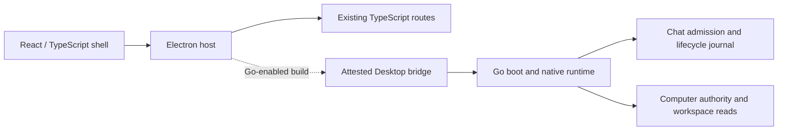

# Farol

Farol connects ChatGPT to folders you choose on your Mac. Its desktop browser,
Computer access controls and operation status keep workspace access explicit.
**Farol Dev** uses a separate profile and connection from the installed app.

[Using Farol](docs/owner-preview.md#setup-inside-the-app) ·
[Development](#develop-from-source) · [Architecture](#source-architecture) ·
[Documentation](docs/README.md)

## Status and scope

Farol is an **owner beta for macOS on Apple Silicon**. This page describes the current source
integration tree. Accepted `main`
remains `acb131d9e7d483296d4edac262cf881cddfb91bb`; integrating source does not
update the installed product.

| State                            | Scope                                                                                                                                                                                                                                                                                                   |
| -------------------------------- | ------------------------------------------------------------------------------------------------------------------------------------------------------------------------------------------------------------------------------------------------------------------------------------------------------- |
| Published baseline               | [0.1.8-owner.beta.1](https://github.com/legrch/farol-releases/releases/tag/v0.1.8-owner.beta.1), build `10`, source `1eb30bd23df22c9581d277280f8e0699612786b5`. Release metadata was checked on 3 October 2026; the beta is unsigned and not notarized.                                                 |
| Accepted main                    | K0/K1 Go foundation and disposable Computer read evidence. It does not establish a shipping Go backend.                                                                                                                                                                                                 |
| Source checkpoint described here | A Go-enabled package has passed normal startup, React Home/Settings, confirmed Quit and same-build empty-profile reopening. Computer read → Chat Send and provider journeys remain unqualified. Source metadata says `0.1.9-owner.beta.1`, build `11`; this is not a new release or installation claim. |
| UI target                        | React + TypeScript shell is composed. Plain TypeScript retains Electron/browser mechanics. Native empty-profile Home, Settings and Appearance have been exercised.                                                                                                                                      |

The Go cutover is incomplete. Source tests do not prove a packaged route, a live
provider turn, streaming or a second message in the same conversation.

The last owner-reported installation was `0.1.8-owner.beta.1`, build `10`. That
report is separate from release metadata; installation was not reverified for
this source checkpoint. The local candidate described below is packaged and tested; it is not installed or live-provider qualified.

## Use and installation

The existing Computer route supports approved workspace instructions, guidance,
list/search/read and explicitly enabled guarded file changes. Workspace shell
and full Git/history require separate approval and verification. Shell network
access remains denied; full Git can expose older excluded content and approved
user Git settings. Activity and support export retain content-free diagnostics.
The Farol Model route and Product Agent remain disabled.

The published beta includes a ZIP, release manifest and checksum file. **First
installation by an external recipient from that ZIP is not currently documented
and qualified as a supported end-to-end workflow.** The first-recipient install
and adoption mechanism remains product implementation work. A manual app copy
does not establish an accepted updater baseline.

The documented owner workflow is:

1. Prepare [source development](#develop-from-source). From accepted clean
   committed source, build a verified packaged candidate with `task package`.

   Then `task run` verifies it again and opens an isolated launch snapshot without
   installing it.

2. Follow [local promotion](docs/owner-preview.md#optional-local-promotion--owner-action-only):
   inspect `task promote`, then explicitly choose its documented apply action only
   when the destination and receipt are absent. This creates
   `$HOME/Applications/Farol.app` and its verified installation receipt. Preserve
   an occupied slot through the [closed cutover](docs/product-cutover.md).
3. Open **Farol** and use **Setup** to choose folders, configure the tunnel and
   select the exact connected ChatGPT app. Embedded sign-in is optional for
   Computer-only use. The embedded connection check sends one message only when
   selected; the external manual check is a separate option.

This owner workflow does not qualify external ZIP installation. An established
installed baseline uses **Check for Updates…** and the
[documented update lifecycle](docs/installed-update-runtime.md). Closing the window
leaves Farol running; **Command+Q** quits it. See the [user guide](docs/owner-preview.md)
for access controls and recovery. Unknown outcomes are not permission to retry.

## Develop from source

The checkout contains the source, resources, tests and build tooling. Use macOS
ARM64, Node **24.20.0 or 26.7.0**, npm **11.19.0**, Go **1.26.2**, the `task` CLI
and Apple Command Line Tools. The complete source gate also requires `gitleaks`.
Build tooling verifies pinned compiler, SDK, dependency and native-helper bytes;
installing a similarly named toolchain does not satisfy those checks.

With the declared Node/npm pair on `PATH`, from the repository root:

```sh
npm ci --ignore-scripts --no-audit --no-fund
node node_modules/esbuild/install.js
node node_modules/electron/install.js
npm run check:toolchain
task dev
```

`task dev` builds current files, including uncommitted edits, and runs the isolated
Farol Dev profile. **Ctrl+C** stops what it started. It does not select the optional
Go backend recipe below or turn a development build into a package candidate.

| Existing command | Purpose                                                                                                                        |
| ---------------- | ------------------------------------------------------------------------------------------------------------------------------ |
| `task test:core` | Generated wire/import checks, root and transitional nested Go race/vet checks, bridge tests and strict TypeScript compilation. |
| `task ci:fast`   | Complete deterministic source gate, including core, coverage, Hunt, output layout and secret scanning.                         |
| `task package`   | Build and verify a candidate from exact clean committed bytes.                                                                 |
| `task run`       | Verify the existing candidate against source and open its private launch snapshot.                                             |
| `task test:e2e`  | Separate packaged Electron checks with explicit display/focus requirements.                                                    |

The proposed test-command registry is not adopted. In the current
[`package.json`](package.json), `npm run test:unit` selects **both** `tests/unit`
and `tests/integration`; it is not a unit-only gate. Use the actual
[`Taskfile.yml`](Taskfile.yml) and [testing policy](docs/testing.md).

The [repository checkpoint policy](AGENTS.md) permits targeted verification,
self-review and `git diff --check`, followed by an owned-only checkpoint commit.
Freeze a coherent integration candidate before `task ci:fast` and its risk-selected
independent review. Hunt requires clean committed source. A checkpoint preserves
work; it is not product acceptance. See [standalone build guidance](docs/standalone-build.md).

### Optional declared Go backend build

The existing candidate command accepts an explicit local input declaration:

```sh
task package -- --go-inputs="$HOME/farol-build/go-inputs.json"
```

This is a source-supported build entrypoint, **not a production-qualified recipe**.
It requires clean committed source and a separately prepared declaration. The
JSON file must have schema `farol-go-build-inputs/1` and these fields:

- `toolchain`: canonical absolute SDK `root`, independently approved full-SDK
  `treeSha256`, `version: "go1.26.2"`, `goos: "darwin"`, and `goarch: "arm64"`
  for the current desktop target. A freshly measured digest is not approval.
- `moduleInputs`: explicit entries for `golang.org/x/sys` `v0.35.0` and
  `golang.org/x/text` `v0.28.0`, each with `modulePath`, `version`, `zipPath`,
  `modPath`, `contentRoot` and optional `zipHashPath`. Supply canonical absolute
  local paths; authentication uses committed `go.sum` and fails on missing inputs.

See the [input parser](tooling/go-build-inputs.mjs) and
[backend builder](tooling/go-backend-build.mjs) for exact validation. The builder
embeds the backend declaration into the Electron host and emits build schema `4`;
packaging uses schema `7`. Without `--go-inputs`, the build retains the TypeScript
Computer selection and package schema `6`. Both paths still compile the separate
Go archive helper; neither establishes installed Go Computer acceptance.

`task package` remains the sole candidate producer. Its Go-enabled artifact needs
normal Electron/native/package qualification before use as an accepted product.
Direct execution inside `_output/package` is unsupported. Package creation,
installation, update/rollback and live provider qualification are separate steps.

## Source architecture

The Farol-owned shell is React + TypeScript. Electron and browser mechanics remain
plain TypeScript. The optional Go host is wired through trusted profile and artifact
checks:



In this source, `chat.turn` supplies Computer admission. The native Chat owner
also composes a typed browser exchange, bounded result retention and conversation
methods. Controlled-peer tests through the normal Go CLI cover useful streaming,
the first Home-to-conversation binding, same-conversation follow-up and a lost
acknowledgement without another Send.
The normal host now composes the browser pump and physical adapter. Its production
control catalogue and real DOM/provider journey remain unqualified;
these source tests are not a working packaged model route.

The selected Task facade also maps create, observe, exact dispatch status/result,
same-thread continuation, exact-session resume and retained progress into the
common framed protocol. Controlled in-memory boundaries exercise the real Task
service, Codex transport and Claude Host/Computer service chain, including useful
output before terminal, historical results and lost-ACK no-repeat behavior.
The Claude execution lease is selected only after Task admission. `NativeRuntime`
does not yet register these Task routes: trusted selection, native qualification
and real Codex/Claude journeys remain separate acceptance work.

| Location                                                                                 | Ownership at this checkpoint                                                                                                                     |
| ---------------------------------------------------------------------------------------- | ------------------------------------------------------------------------------------------------------------------------------------------------ |
| [`src/`](src/)                                                                           | React shell under `src/ui/renderer/`, Electron/browser adapters, transitional services and composition.                                          |
| [`apps/desktop/`](apps/desktop/)                                                         | Attested Go host, authority publication and generated Go/TypeScript wire bridge.                                                                 |
| [`boot/`](boot/), [`cmd/farol/`](cmd/farol/), [`transport/desktop/`](transport/desktop/) | Go composition, entrypoint, native profile lifetime and framed protocol.                                                                         |
| [`modules/computer/`](modules/computer/)                                                 | Authority, filesystem and process services. Native ingress selects catalogue/bootstrap/read; other prepared capabilities need their own cutover. |
| [`modules/chat/`](modules/chat/)                                                         | Turn, queue, admission, browser exchange and bounded retained results; real browser host composition remains unqualified.                        |
| [`modules/task/`](modules/task/)                                                         | Coding-task lifecycle and provider adapters; shipping task-route qualification remains separate.                                                 |
| [`modules/release/`](modules/release/)                                                   | Update/recovery, journal and identity/adoption preparation; the existing updater is still active.                                                |

Domain and application code use values and consumer-owned ports. Neighbors cross
published contracts through `infra/peer`; Go contracts map independent DTOs and
delegate to their own module. Root `boot/` composes Go and `src/boot/` composes the
remaining TypeScript. Core does not become a second authority or journal owner.
The exact local `c1d67c0` package passed the bounded normal-main startup/reopen
journey in [Desktop/Core evidence](docs/desktop-core.md#normal-startup-and-empty-profile-reopen-candidate).
Component and source checks alone do not establish packaged or installed behavior.

The [documentation index](docs/README.md) links module contracts, migration limits,
installation and verification. Unsigned distribution, remaining Python helpers,
first-recipient installation and normal Go product qualification remain open.
