> **Dark illustration preview** · [Switch to the matched light preview](docs/media/dark/light-preview.md). Remove this banner when a style is chosen.

<div align="center">


# Farol

### Give ChatGPT your Mac's folders. It reads, explains and edits them.

Ask in the ChatGPT you already use. Farol, a small native app on your Mac, lets it work with the folders **you** approve: read a whole project, find the note you need, or write the change straight into your file.

[](#before-you-start)
[](https://github.com/legrch/farol/releases/latest)
[](#before-you-start)

**[Install](#install-in-one-line)** · [What you can do](#what-you-can-do-with-it) · [Connect ChatGPT](#connect-chatgpt-step-by-step) · [First request](#try-your-first-file) · [Permissions](#stay-in-control) · [Help](#if-something-gets-stuck)

</div>

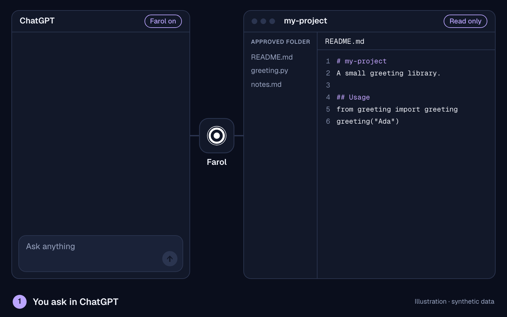

## Install in one line

Open **Terminal**, paste this, press Return:

```sh
curl -fsSL https://raw.githubusercontent.com/legrch/farol/main/scripts/install-release.sh | sh -s -- latest
```

It finds the newest release, downloads it, verifies the checksums and the release tree, installs Farol and opens it. Then [connect it to ChatGPT](#connect-chatgpt-step-by-step).

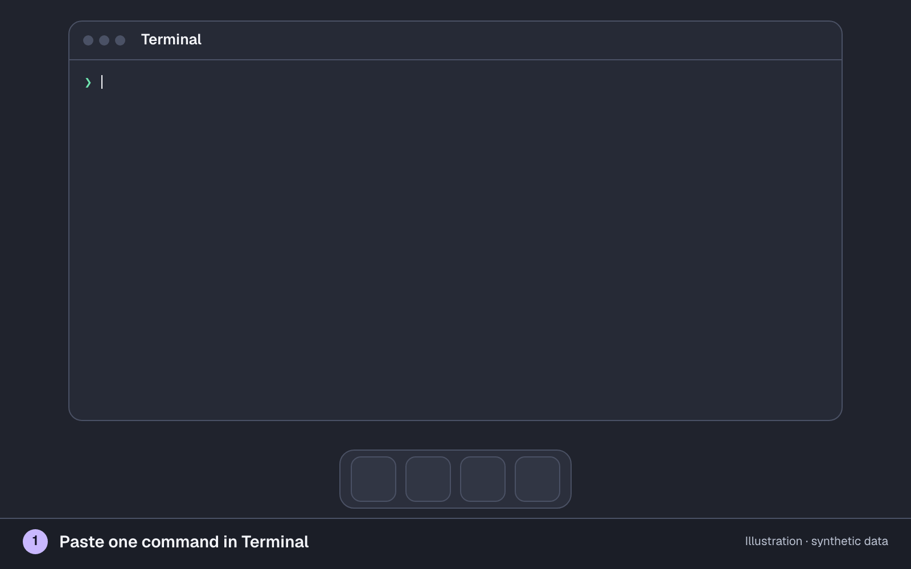

> [!IMPORTANT]
> **Farol is in beta and is not signed or notarized by Apple yet.** You need an Apple Silicon Mac and a ChatGPT account or workspace that offers **Developer mode and Tunnel connections**. [What the installer checks](docs/start/installation.md).

> [!TIP]
> **Already have Farol?** Do not reinstall. Use **Settings → General → Check for updates** inside the app.

<a id="what-can-i-do-with-it"></a>

## What you can do with it

Copy a request, change the names, and send it in a chat with Farol selected.

| Use case                     | Ask ChatGPT                                                                          |
| ---------------------------- | ------------------------------------------------------------------------------------ |
| 🧭 **Learn a project**       | “Read this project and explain how it is organized. Where should I start?”           |
| 🔎 **Find it in your notes** | “Find my notes about the connection setup and quote the relevant part.”              |
| 📄 **Summarize documents**   | “Read the documents in `contracts` and list the dates I need to remember.”           |
| 🐞 **Track down a bug**      | “Read `checkout.py` and the failing test. Explain why it fails and propose the fix.” |
| ✍️ **Write code**            | “Add a `greeting(name)` function and a test for it.”                                 |
| 🧹 **Clean up your docs**    | “Update the README so the install steps match the code. Show me what changed.”       |

The last two need **Read & write** on that folder. Everything else works with the default **Read only**.

### Like a coding agent, in your own chat

Grant **Read & write** to one folder and ChatGPT can do more than talk about your code: it reads the file first, writes the change, creates new files, and tells you what to review.

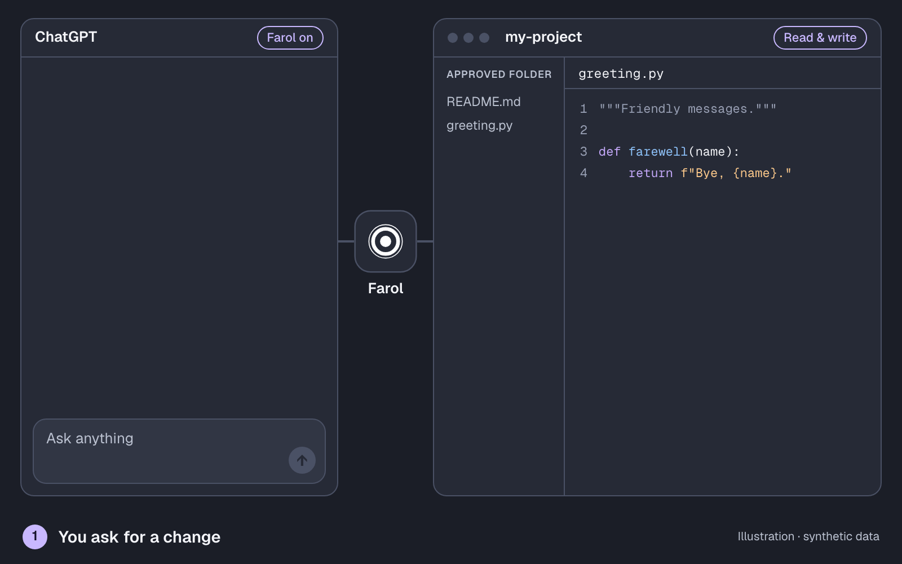

_All animations are illustrations with synthetic data, not screen recordings or proof of a live setup. File contents and tool results that ChatGPT requests are returned to ChatGPT._

### Why Farol

|                                |                                                                                                                       |
| ------------------------------ | --------------------------------------------------------------------------------------------------------------------- |
| **No more copy and paste**     | ChatGPT opens the files it needs, instead of you uploading them one at a time.                                        |
| **Changes land in your file**  | Edits are saved in the real folder on your Mac, so you can review them in your own editor or with Git.                |
| **You choose the folders**     | Nothing is shared until you approve a folder. Every new folder starts **Read only**.                                  |
| **Separate switches for risk** | Folder access, running commands and ChatGPT's confirmations are three separate controls. [Details](#stay-in-control). |
| **Your ChatGPT, your account** | You keep working in your own ChatGPT account and workspace. Farol connects it to your Mac through an OpenAI Tunnel.   |
| **Bundled and self-contained** | Farol includes its Node runtime and Go backend, so you do not need to install them.                                   |

<a id="use-and-installation"></a>
<a id="install-and-connect"></a>
<a id="supported-macs"></a>
<a id="download-and-installation"></a>

## Before you start

| You need                                               | Notes                                                                                               |
| ------------------------------------------------------ | --------------------------------------------------------------------------------------------------- |
| **Apple Silicon Mac**                                  | Intel Macs, Windows and Linux have no package. The clean-Mac macOS matrix is still being qualified. |
| **ChatGPT with Developer mode and Tunnel connections** | Availability varies by account and organization.                                                    |
| **Access to OpenAI Platform**                          | You create a tunnel and a restricted key there during setup.                                        |
| **A small, non-sensitive folder to try first**         | You can add real projects afterwards.                                                               |

Prefer to download by hand? Inspect the [release assets](https://github.com/legrch/farol/releases/latest), then run `shasum -a 256 -c SHA256SUMS` next to the ZIP, `farol-release.json` and `SHA256SUMS`. A matching checksum does not establish developer identity or notarization. If macOS refuses the app, keep the warning: removing quarantine or disabling Gatekeeper is not an installation step.

## Connect ChatGPT step by step

Seven steps, about one screen each. Setup in the app walks you through them; the same actions are shown here. Values in the animations are synthetic.

**Jump to:** [Sign in](#1-sign-in-to-chatgpt) · [Choose a folder](#2-add-a-workspace) · [Create a tunnel](#3-create-a-tunnel) · [Restricted key](#4-create-a-restricted-key) · [Connect this Mac](#5-connect-this-mac) · [Add to ChatGPT](#6-add-farol-to-chatgpt) · [Test](#7-test-the-connection)

### 1. Sign in to ChatGPT

1. Open **Setup → Start setup** and choose **Sign in** or **Open ChatGPT**.
2. Use your own ChatGPT account, then return to Setup. If confirmation is still needed, choose **Check sign-in**.
3. Wait for **✓ Sign-in checked**, then choose **Continue**. This does not yet grant local file access.

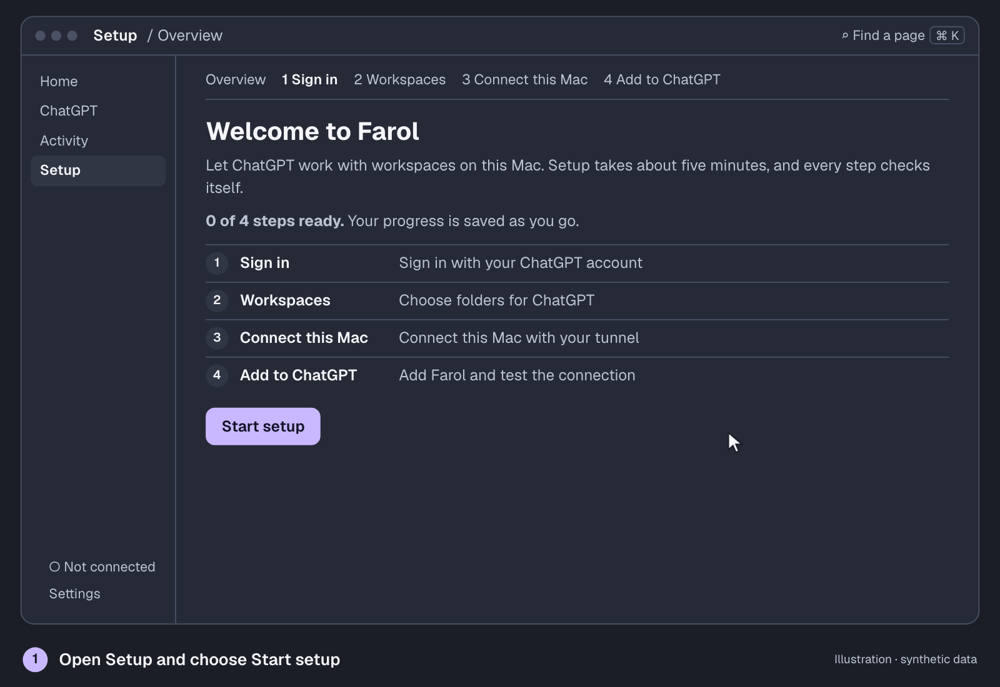

### 2. Add a workspace

A **Farol workspace** is a folder you approve on your Mac. It is not the same thing as your ChatGPT workspace, which is the account or team context in ChatGPT.

1. In **Workspaces**, choose **+ Add workspace** and select a small, non-sensitive sample folder.
2. Review the path and saved **Read only** access. Wait for **✓ Works**; every listed workspace needs a current check.
3. Choose **Continue** when the checks are current.

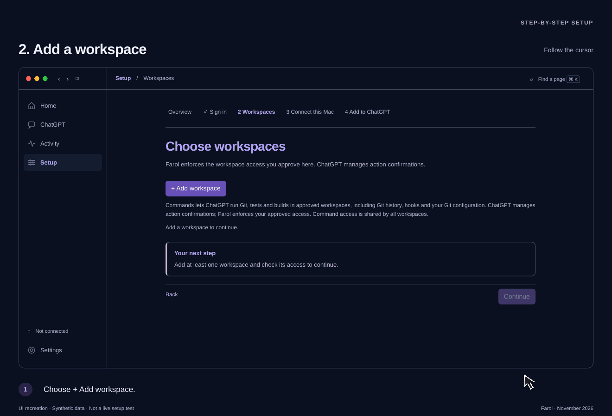

#### Optional: edits and commands

Keep Read only and Commands off for the first exercise. When a task needs changes, choose **Read & write** in that workspace's row and wait for the saved access check. Review **Commands** separately: it is shared across approved workspaces, not a per-folder sandbox.

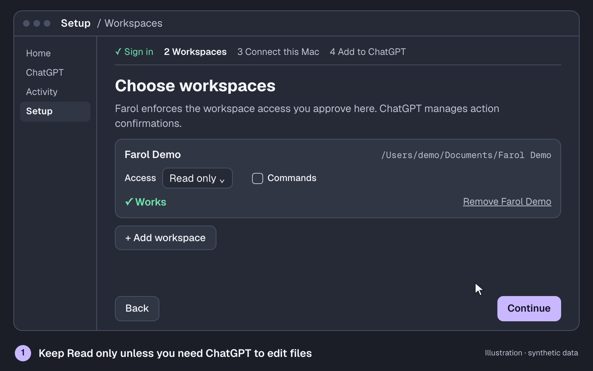

### 3. Create a tunnel

1. From **Connect this Mac**, choose **Open OpenAI Tunnels** in the intended Platform organization. Reuse an existing tunnel if you have an appropriate one.
2. For a new tunnel, fill **Name** and **Description**, review **Organizations**, and select the intended **ChatGPT workspaces**. A workspace may display as an ID.
3. Choose **Create** once. Copy the complete tunnel ID from its row.
4. Paste that ID into Farol **before** copying the key, so the next copy does not replace your only copy of the ID.

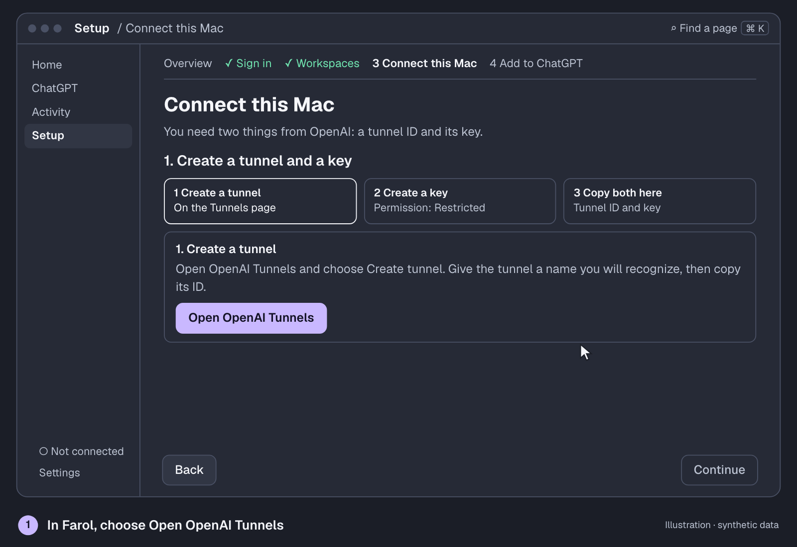

### 4. Create a restricted key

1. Open the API-key form and choose the intended project and expiration under your organization's policy.
2. Choose **Restricted**. Under **Tunnels**, select **Read** and **Use** only; leave unrelated permissions at **None**.
3. Use **Save your key → Copy → Done**, then return to Farol.

> [!WARNING]
> Do not substitute a full-access or admin key, and never paste a key into a chat, repository, screenshot or support message.

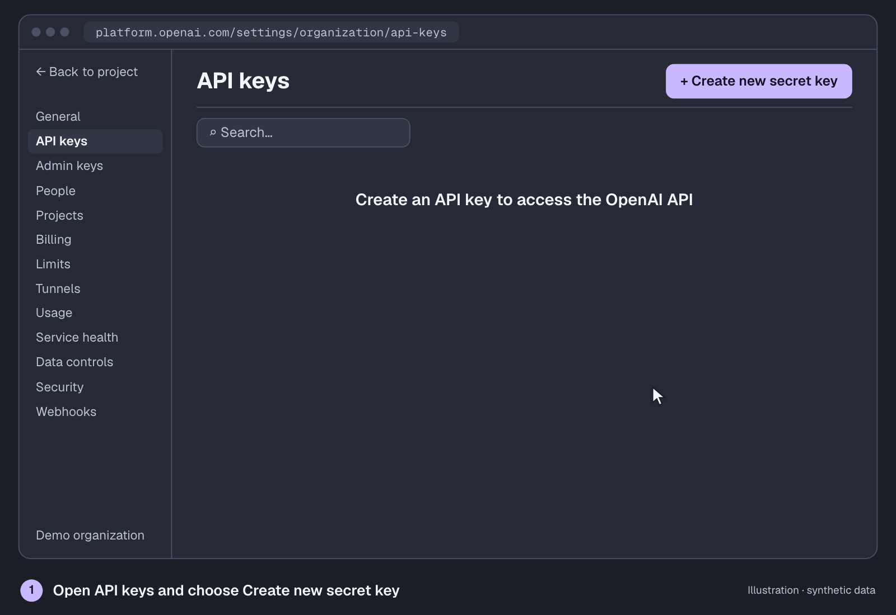

### 5. Connect this Mac

1. Confirm the **Tunnel ID** is present and paste the key into Farol's masked **Key** field.
2. Choose **Connect** once. Wait for the result; do not resubmit while it is pending or unknown.
3. Continue after **✓ Connected**. If Farol says **Key saved**, the empty field keeps the saved key, so do not paste a replacement.

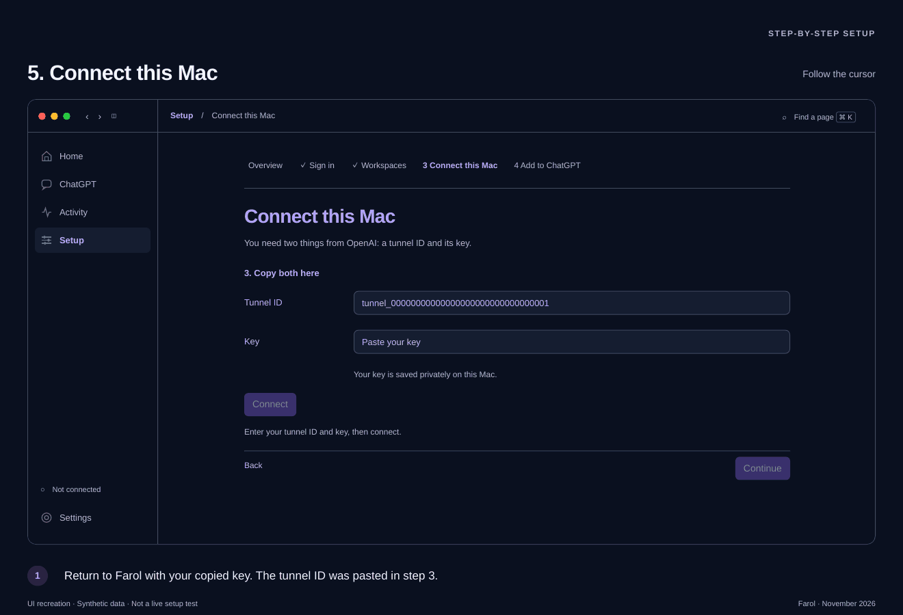

### 6. Add Farol to ChatGPT

1. Choose **Open ChatGPT Apps** in Farol. In the intended ChatGPT workspace, open **Plugins → Add → Add custom MCP server**. Reuse a plugin already attached to the same tunnel.
2. Set **Name** to the app name shown in Farol, **Connection: Tunnel**, the same **Tunnel ID**, and **Authentication: No authentication**. Read the risk disclosure, then choose **Create as a plugin**.
3. Review the **Connect** dialog and data-sharing notice. Choose **Connect** once and find Farol in the plugin list.
4. Open **⋯ → Manage → Permission**. **Recommended: keep Allow low-risk tools (Default).**

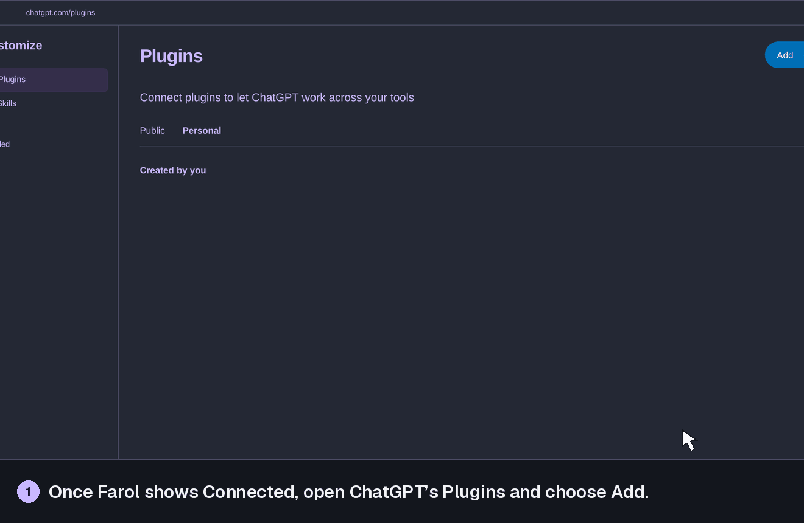

### 7. Test the connection

1. Return to Farol and choose **Test in ChatGPT** once. It uses a separate ordinary chat and the exact app name saved for this tunnel.
2. Wait for the original test. **Back to setup** returns without sending again.
3. Choose **Start using Farol** after **✓ Everything works**. A model reply or plugin chip alone does not establish this result.

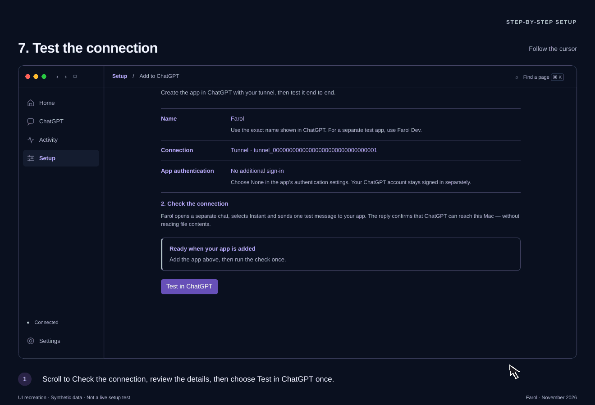

## Try your first file

1. In Finder, create a folder called `Farol sample` with `hello.txt` containing `This is my Farol sample.`
2. Add it in **Setup → Workspaces**. Keep **Read only**, leave **Commands** off, and wait for **✓ Works**.
3. Select the Farol plugin in a ChatGPT conversation and send:

```text
Use Farol to list my approved workspaces and read hello.txt in the Farol sample workspace. Do not change files or run commands.
```

Compare the result with your file. That is the whole loop: a question in ChatGPT, a read from an approved folder, and the answer back in the conversation. [More about the sample exercise](docs/start/first-workspace.md).

<a id="privacy-and-security"></a>
<a id="choose-folder-access"></a>
<a id="best-practices"></a>

## Stay in control

Three separate switches decide what can happen. Changing one does not change the others.

| Control                              | What it decides                                              | Start with                                                   |
| ------------------------------------ | ------------------------------------------------------------ | ------------------------------------------------------------ |
| **Workspace access** (in Farol)      | Which folders, and whether supported file edits are allowed. | **Read only**, on a project folder rather than your home     |
| **Commands** (in Farol)              | Running commands. Shared across all approved workspaces.     | **Off**, until you have reviewed Git hooks and configuration |
| **ChatGPT Permissions** (in ChatGPT) | When ChatGPT asks you before calling a tool.                 | **Allow low-risk tools (Default)**                           |

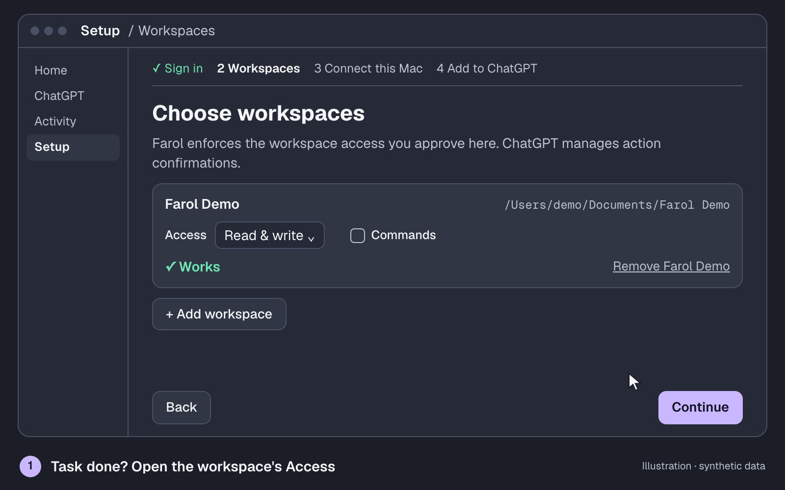

The other ChatGPT choices are **Always ask**, **Allow read-only tools** and **Allow all tools (Elevated risk)**. Allow all tools is optional and not needed for this guide. [Compare the choices](docs/guides/best-practices.md#choose-chatgpt-permissions-deliberately).

- **Read only limits changes, not disclosure.** Contents ChatGPT requests go to ChatGPT, and an approved folder or its history may contain sensitive material. [Privacy and data sharing](docs/guides/privacy.md).
- **Ask for one clear change, then check it.** Keep a backup or a Git baseline. A success message alone does not prove the file changed; inspect the file or diff.
- **Narrow access afterwards.** Set a folder back to **Read only**, or use **Remove [workspace name]**. Removing a workspace keeps its files on disk.
- **Protect the key.** Use a Restricted key with **Tunnels Read + Use**, and keep it out of chats, repositories and screenshots.
- **Do not retry uncertain actions.** Choose **Connect** or **Test in ChatGPT** once. If a result is pending or unknown, use **Review unresolved actions** and observe the original operation. [Recovery](docs/guides/recovery.md).

## If something gets stuck

Start with the state Farol actually shows, and note the version and exact error.

| What you see                                        | What to do first                                                                                                                                                                 |
| --------------------------------------------------- | -------------------------------------------------------------------------------------------------------------------------------------------------------------------------------- |
| **macOS refuses to open Farol**                     | Keep the warning. The app is unsigned and not notarized; do not remove quarantine or disable Gatekeeper.                                                                         |
| **Connection helper needed**                        | Read the cause in **Connect this Mac**. Farol uses its bundled helper; installing an unrelated tunnel-client does not repair it.                                                 |
| **Tunnel or key refused**                           | Check the intended ChatGPT workspace and tunnel ID. Use a Restricted key with Tunnels Read + Use. If **Key saved** appears, the blank field is intentional.                      |
| **Farol is connected, but ChatGPT cannot reach it** | Select the plugin attached to the same tunnel and Farol instance, and reuse it rather than creating another. A local Connected status does not establish the ChatGPT attachment. |
| **Workspace access refused**                        | Review the saved path, Access choice, exclusions and **✓ Works**. Use **Check access** if offered. Broader access is not a fix for an unavailable tool.                          |
| **A folder moved** (`WORKSPACE_ROOT_CHANGED`)       | Preserve pending work, then deliberately remove and re-add the folder and review its new grant.                                                                                  |
| **A result is pending or unknown**                  | Open **Review unresolved actions**, then **Refresh status** to observe the original operation. Do not repeat Connect, Test or an edit, delete state, or change tunnels.          |
| **An update is blocked**                            | Read the stated blocker. Pending work or an active session can block an update. Settle the original work; do not replace the app or delete its journals.                         |

More in [Connection troubleshooting](docs/guides/troubleshooting.md).

<a id="updates-and-recovery"></a>
<a id="need-help"></a>

## Updates

Closing the window leaves Farol running; **Command+Q** quits it. To update an installation set up for trusted updates:

1. Open **Settings → General → Check for updates** and review the offered version and release notes.
2. Choose **Download Update** and wait for verification.
3. Finish active work, then choose **Install and Relaunch** once.
4. After relaunch, check the version and connection status.

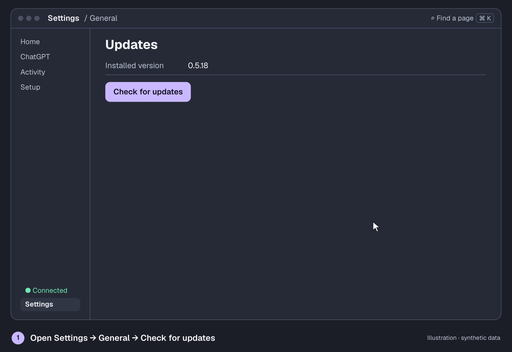

For an interrupted update, open **Settings → General → Update recovery…** and use only the action offered. [Update Farol](docs/guides/updates.md) · [Uninstall safely](docs/guides/uninstall.md)

## Go deeper

This page is the guide. These pages hold the exceptional detail:

[Installation details](docs/start/installation.md) · [Connection steps](docs/start/setup.md) · [Workspace access](docs/guides/folder-access.md) · [Best practices](docs/guides/best-practices.md) · [Recovery](docs/guides/recovery.md) · [All documentation](docs/README.md)

<a id="develop-from-source"></a>
<a id="declared-go-backend-inputs"></a>
<a id="source-architecture"></a>
<a id="status-and-scope"></a>

## For developers

After `task package` builds a verified packaged candidate, `task run` opens its isolated launch snapshot; `task dev` is the separate development lane.

[Development and contributing](docs/development/README.md) · [Technical references](docs/reference/README.md) · [Go module indexes](docs/reference/modules/README.md) · [First-install readiness](docs/reference/install-readiness.md) · [Animation sources](docs/media/dark/README.md)

The [dated capability reference](docs/reference/status.md) separates source, package and installed evidence. Tasks, Agent workflows, Git SSH and PDF transfer still require separate acceptance.
