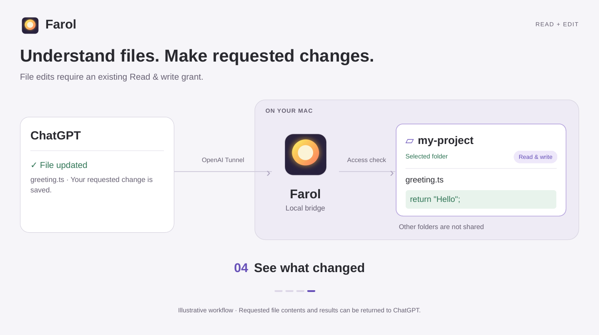

# Farol

### Your local files, connected to ChatGPT.

Find answers in your files, understand a project, and make requested changes from the conversation. **You choose the folders Farol can access on your Mac.**

**[Get started →](docs/start/installation.md)** · [See it in action](#see-it-in-action) · [Setup guide](docs/start/setup.md) · [Documentation](docs/README.md)

**macOS · Apple Silicon · Beta**

## From a question to your files

Farol is a Mac app that connects selected local folders to ChatGPT. Add a folder as a **workspace**, connect Farol in ChatGPT, and ask about the files inside it. Enable **Read & write** when a task needs edits.

| Find an answer                               | Understand a project                              | Make a requested change                             |
| -------------------------------------------- | ------------------------------------------------- | --------------------------------------------------- |
| “Find the notes about connection setup.”     | “Read the README and explain this project.”       | “Fix this sentence in the document.”                |
| Search and read files in an approved folder. | Give ChatGPT the local context for your question. | Save supported file edits with Read & write access. |

These are example requests; available tools and results depend on your build, saved access and ChatGPT permissions. [Explore what Farol does →](docs/start/overview.md)

## See it in action

**Read a file. Get an answer.** Follow a request from ChatGPT to a selected folder and back. Then see how an explicitly permitted edit reaches the file.

<strong>▶ Watch: read a file through Farol · 15 seconds</strong>

[View the static illustration](docs/media/workflow/output/Farol-how-it-works-light.png). Collapse this section to hide the looping animation.

<strong>▶ Watch: make a requested edit · 15 seconds</strong>

[View the static illustration](docs/media/workflow/output/Farol-read-and-edit-light.png). Collapse this section to hide the looping animation.

_Illustrated workflows with synthetic data, not screen recordings. The edit example assumes an existing Read & write grant. Requested file contents and tool results can be returned to ChatGPT._

## Your folders. Your access choices.

- **Choose what to share.** Add the folders you need as Farol workspaces; start with a small, non-sensitive sample.
- **Start with reading.** New workspaces use Read only. Enable Read & write when you need supported file changes.
- **Review commands separately.** Commands is a separate grant shared across approved workspaces. ChatGPT's tool-confirmation settings are another independent choice.

Requested file contents and results can leave your Mac for ChatGPT. Read only limits changes, not disclosure. [Privacy and security](docs/guides/privacy.md) · [Access and permission choices](docs/guides/best-practices.md)

## Start here

**[Installation and requirements →](docs/start/installation.md)**

Farol is currently a beta for Apple Silicon Macs. Public downloads are unsigned and not notarized; a supported first-install procedure is still being qualified. The installation page explains what is available and where to continue. Keep an existing working accepted installation and use its updater.

| Step                 | What you do                                                          | Where to go                                           |
| -------------------- | -------------------------------------------------------------------- | ----------------------------------------------------- |
| **1 · Installation** | Check Mac/account requirements and the current installation path.    | [Installation guide](docs/start/installation.md)      |
| **2 · Connection**   | Sign in, choose a folder, connect this Mac and add Farol to ChatGPT. | [Visual setup guide](docs/start/setup.md)             |
| **3 · First result** | Ask ChatGPT about a sample file with Read only access.               | [Your first workspace](docs/start/first-workspace.md) |

Already have an accepted running installation? **[Go straight to setup →](docs/start/setup.md)** The guide includes all eight setup animations, written steps and static alternatives. No animation is required to follow it.

## Keep going

[Everyday use and best practices](docs/guides/best-practices.md) · [Update Farol](docs/guides/updates.md) · [Troubleshoot a connection](docs/guides/troubleshooting.md) · [Recover interrupted work](docs/guides/recovery.md)

Open the outer **Farol.app**, not its nested Electron Runtime.app. Closing the window leaves Farol running; **Command+Q** quits it. [Installation locations](docs/start/installation.md#installation-paths-and-adoption) · [Uninstall](docs/guides/uninstall.md)

## For developers

After `task package` builds a verified packaged candidate, `task run` opens its isolated launch snapshot; `task dev` is the separate development lane.

[Development and contributing](docs/development/README.md) · [Technical references](docs/reference/README.md) · [Go module indexes](docs/reference/modules/README.md) · [Capability evidence and limits](docs/reference/status.md) · [First-install readiness](docs/reference/install-readiness.md) · [Animation sources](docs/media/onboarding/README.md)

The dated status reference separates source, package and installed evidence; it is not a live release catalogue. Tasks, Agent workflows, Git SSH and PDF transfer still require separate acceptance.
