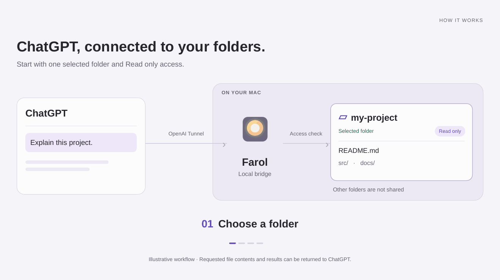
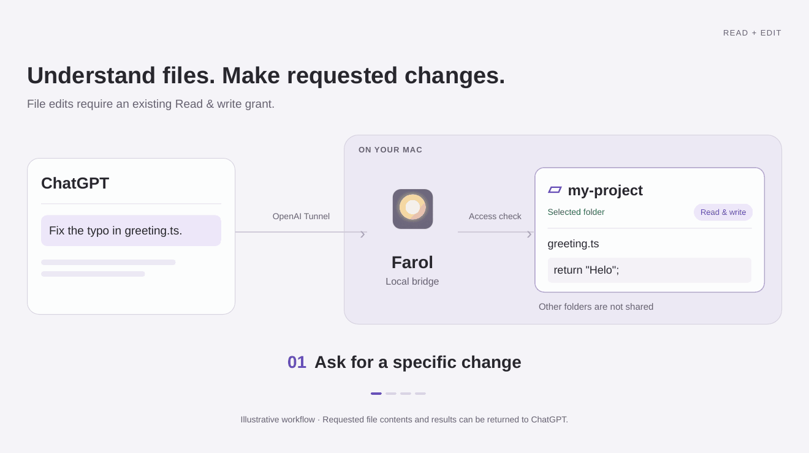
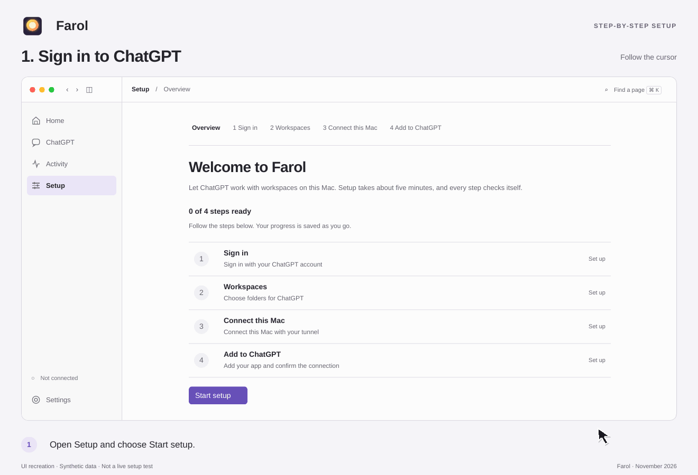
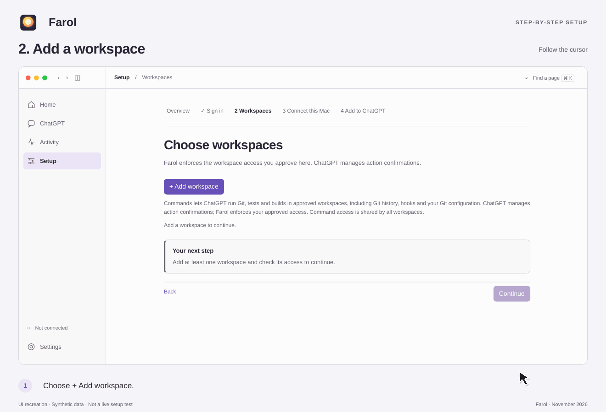
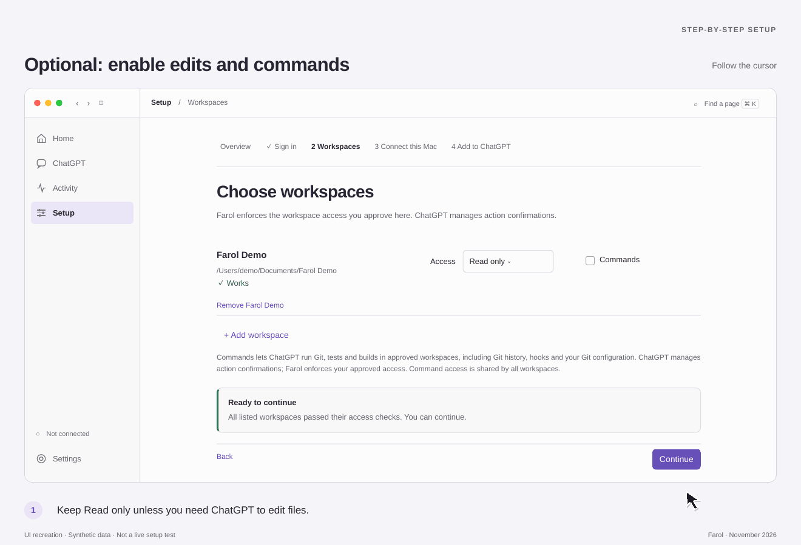
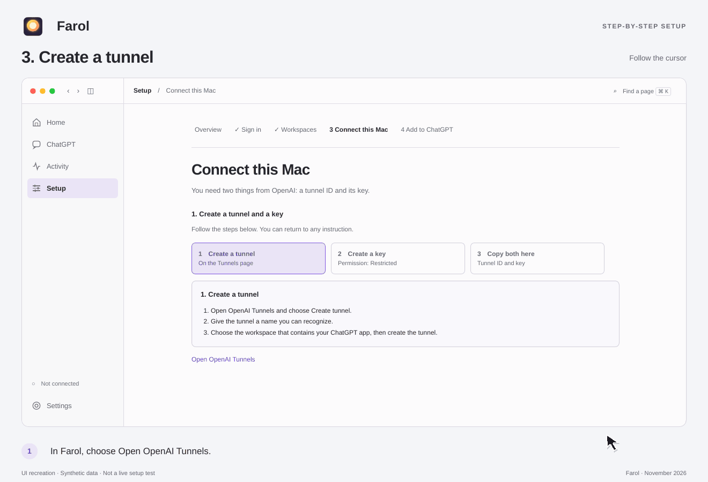
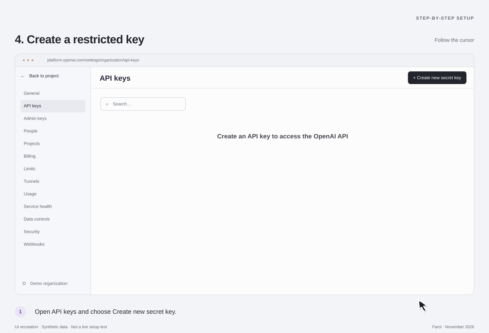
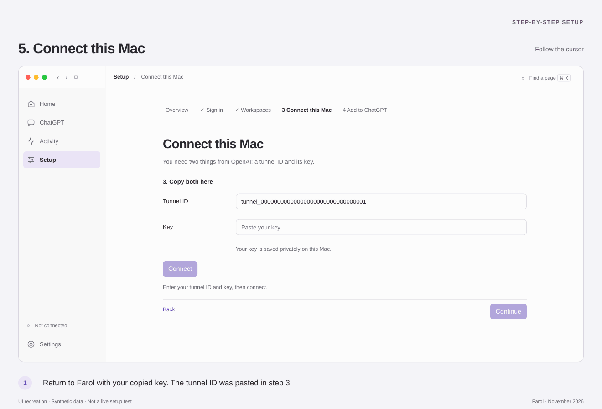
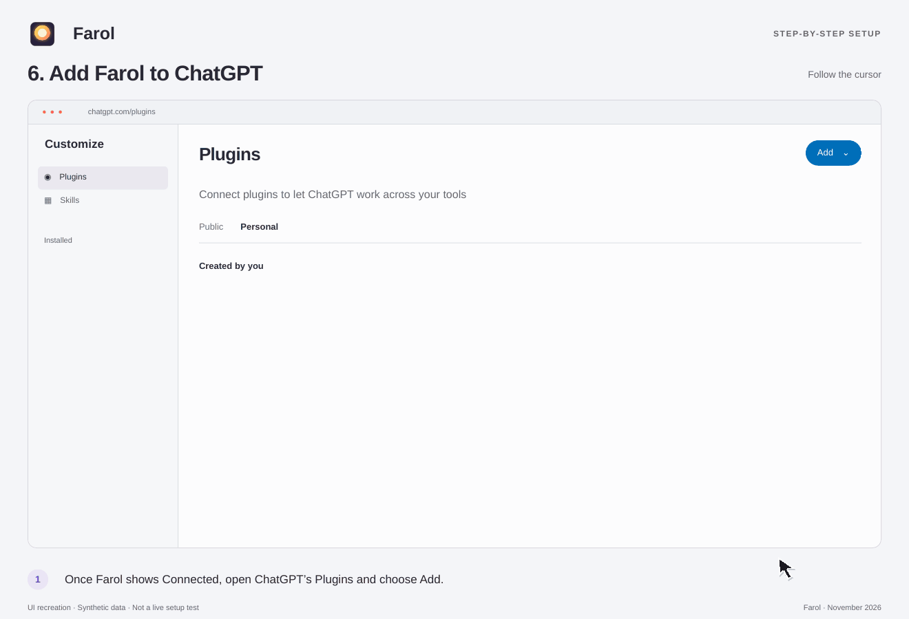
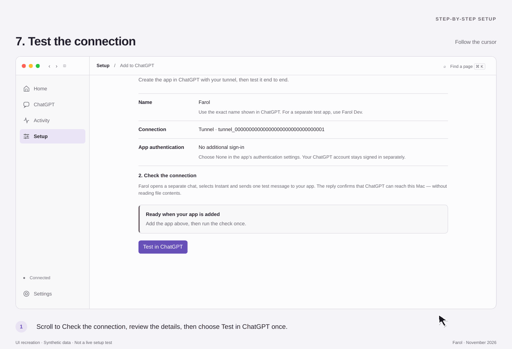

<div align="center">


# Farol

### Your local files, connected to ChatGPT.

Find answers in your files, understand a project, and make requested changes from the conversation. **You choose the folders Farol can access on your Mac.**

**[Get started ↓](#install-and-connect)** · [See it in action](#see-it-in-action) · [Your first request](#try-your-first-file) · [Best practices](#best-practices)

**macOS · Apple Silicon · Beta**

</div>

## See it in action

### Ask about your files

Choose a local folder in Farol, then ask ChatGPT to find and read the information you need. Farol connects the conversation to that approved workspace through an OpenAI Tunnel.



### Make a requested change

Need an edit? Enable **Read & write** for that workspace, ask for a specific change, and inspect the result in your file.



_These are illustrated workflows with synthetic data, not screen recordings or live acceptance evidence. Requested file contents and tool results can be returned to ChatGPT. The edit example assumes an existing Read & write grant._

<a id="what-can-i-do-with-it"></a>

## What will you use it for?

| Find an answer                               | Understand a project                              | Make a requested change                             |
| -------------------------------------------- | ------------------------------------------------- | --------------------------------------------------- |
| “Find the notes about connection setup.”     | “Read the README and explain this project.”       | “Fix this sentence in the document.”                |
| Search and read files in an approved folder. | Give ChatGPT the local context for your question. | Save supported file edits with Read & write access. |

A **Farol workspace** is a folder you approve on your Mac. Your **ChatGPT workspace** is the account or team context in ChatGPT. Farol's folder grants control file access; the tunnel connects the intended ChatGPT workspace. Available tools depend on your build, saved access and ChatGPT permissions.

<a id="use-and-installation"></a>
<a id="supported-macs"></a>
<a id="download-and-installation"></a>

## Install and connect

This is the complete path from requirements to your first file request. Stay on this page and follow the steps below; the additional links provide reference details and help if you get stuck.

**Jump to:** [Download](#before-you-start) · [Sign in](#1-sign-in-to-chatgpt) · [Choose a folder](#2-add-a-workspace) · [Create a tunnel](#3-create-a-tunnel) · [Restricted key](#4-create-a-restricted-key) · [Connect this Mac](#5-connect-this-mac) · [Add to ChatGPT](#6-add-farol-to-chatgpt) · [Test](#7-test-the-connection)

### Before you start

You need an **Apple Silicon Mac** and a ChatGPT account/workspace offering **Developer mode and Tunnel connections**. Account and organization availability can vary. Intel Macs, Windows and Linux do not have a qualified package. A clean-Mac macOS/prerequisite matrix and connection-helper distribution are still being qualified. Farol includes its Node runtime and Go backend; end users do not need a separate Node, npm or Go installation. Ordinary Git and hooks may still need their own toolchains.

**[Public release and download assets →](https://github.com/legrch/farol/releases/latest)**

> **First installation is not ready yet.** Public downloads are unsigned and not notarized, and the supported first-install and trusted-updater procedure is still being qualified. The direct installer is temporarily unavailable. You can inspect the release assets, but wait for an accepted installation procedure before proceeding on a fresh Mac. Keep an existing working accepted installation and use its updater.

On the release page, expand **Assets**. The app is the `Farol-<version>-darwin-arm64.zip` archive; GitHub's **Source code** archives are for developers. The matching `farol-release.json` and `SHA256SUMS` belong to the same release. To inspect a download, save all three together and run this in their directory:

```sh
shasum -a 256 -c SHA256SUMS
```

The ZIP should report `OK`. A matching checksum does not establish developer identity, notarization, installation or updater eligibility. Manually copying the app does not create a trusted updater baseline. If macOS refuses it, retain the warning; removing quarantine or disabling Gatekeeper is not an installation step.

**Already have an accepted installation?** Open the outer **Farol.app**, not its nested Electron Runtime.app. The documented qualified internal location is `/Applications/Farol.app`; older alpha installations used `~/Applications/Farol.app`. Preserve a working app and its data rather than moving or replacing it. For an installation already set up for trusted updates, use **Settings → General → Check for updates**. [Installation details and existing-app locations](docs/start/installation.md).

**Once an accepted installation is running, continue below.** These eight animations show the connection setup inside the app, using synthetic values. They are UI recreations, not recordings or proof of a fresh installation. All animations are visible and loop; the written steps contain the same actions.

### 1. Sign in to ChatGPT

1. Open **Setup → Start setup** and choose **Sign in** or **Open ChatGPT**.
2. Use your own ChatGPT account, then return to Setup. If confirmation is still needed, choose **Check sign-in**.
3. Wait for **✓ Sign-in checked**, then choose **Continue**. This does not yet grant local file access.



### 2. Add a workspace

1. In **Workspaces**, choose **+ Add workspace** and select a small, non-sensitive sample folder.
2. Review the path and saved **Read only** access. Wait for **✓ Works**; every listed workspace needs a current check.
3. Choose **Continue** when the checks are current. [Try a sample workspace](#try-your-first-file) for a complete read-only exercise.



### Optional: edits and commands

Keep Read only and Commands off for the first reading exercise. If a later task needs changes, choose **Read & write** in the workspace row and wait for the saved access check. Review **Commands** separately: it is shared across approved workspaces, not a per-folder sandbox. The animation demonstrates optional changes; it is not a required setup step. See [Best practices](docs/guides/best-practices.md).



### 3. Create a tunnel

1. From **Connect this Mac**, choose **Open OpenAI Tunnels** in the intended Platform organization. Reuse an appropriate existing tunnel if you already have one.
2. For a new tunnel, fill **Name** and the required **Description**, review **Organizations**, and select the intended **ChatGPT workspaces**. A workspace may display as an ID. Review any optional security settings under your organization's policy.
3. Choose **Create** once and observe the result. Copy the complete tunnel ID from its row.
4. Paste that ID into Farol before copying the key, so the next Copy action does not replace your only copy of the ID. A Platform-organization-only tunnel may not be available in ChatGPT.



### 4. Create a restricted key

1. Open the API-key form and choose the intended project and expiration under your organization's policy. The available menus were not verified and are deliberately not illustrated.
2. Choose **Restricted**. Under **Tunnels**, select **Read** and **Use** only; leave unrelated permissions at **None**. “All selected” inside that selector means both Tunnels choices, not full-key access.
3. When the key is created, use **Save your key → Copy → Done**, then return to Farol. Keep the real key private. The visible demo key is invalid and must not be used.

Do not substitute a full-access or admin key. Never paste the key into a chat, repository, screenshot or support message.



### 5. Connect this Mac

1. Confirm the **Tunnel ID** is present and paste the key into Farol's masked **Key** field.
2. Choose **Connect** once. Wait for the existing result; do not resubmit while it is pending or unknown.
3. Continue after **✓ Connected**. This confirms the local connection, not the ChatGPT attachment. If Farol says **Key saved**, leaving the field empty retains it; do not create or paste a replacement just because the field cleared.



### 6. Add Farol to ChatGPT

1. Choose **Open ChatGPT Apps** in Farol. In the intended ChatGPT workspace, open **Plugins → Add → Add custom MCP server**. Reuse a plugin already attached to the same tunnel instead of duplicating it.
2. Set **Name** to the editable app name shown in Farol, **Connection: Tunnel**, the same **Tunnel ID**, and **Authentication: No authentication**. Read the risk disclosure and decide whether to accept it before choosing **Create as a plugin**.
3. Review the separate **Connect** dialog and data-sharing notice. Choose **Connect** once, wait, and find Farol in the plugin list.
4. Open **⋯ → Manage → Permission** to review **Permissions**. **Recommended: keep Allow low-risk tools (Default)** for this guide. The animation leaves this default unchanged.

The other choices are **Always ask**, **Allow read-only tools** (read without asking, but ask before changes), and **Allow all tools (Elevated risk)**. These are the UI descriptions, not guarantees for every call. Allow all tools is optional, requires an informed owner decision and is not necessary to follow this guide. [Compare the permission choices](docs/guides/best-practices.md#choose-chatgpt-permissions-deliberately).



### 7. Test the connection

1. Return to Farol and choose **Test in ChatGPT** once. It uses a separate ordinary chat with Instant and the exact app name saved for this tunnel.
2. Wait for the original test. **Back to setup** returns without sending again.
3. Choose **Start using Farol** after **✓ Everything works** and current workspace checks. A model reply or plugin chip alone does not establish this result. The check does not read file contents.

If a check is already current, continue without repeating it. The successful state in the animation is simulated; it is not proof that your own setup passed.



## Try your first file

1. In Finder, create a small folder called `Farol sample` and add `hello.txt` containing `This is my Farol sample.` Use only non-sensitive files.
2. If you have not added it during setup, add this folder in **Setup → Workspaces**. Keep **Read only**, leave **Commands** off, and wait for **✓ Works**. Every listed workspace needs a current access check.
3. After the matching ChatGPT connection check has passed, select the Farol plugin in a conversation and send:

> Use Farol to list my approved workspaces and read hello.txt in the Farol sample workspace. Do not change files or run commands.

Compare the tool result with your local file. You have now tried the core workflow: a question in ChatGPT, a read from an approved folder, and the result back in the conversation. If access is refused or unavailable, inspect that result rather than granting a broader folder. [More about the sample exercise](docs/start/first-workspace.md).

<a id="privacy-and-security"></a>
<a id="choose-folder-access"></a>

## Best practices

### Start small and keep control

Grant a project folder rather than your whole home directory. New workspaces start **Read only**; this limits changes, not disclosure to ChatGPT. Review the path, exclusions and **✓ Works** before sharing files. An approved folder or repository history may still contain sensitive material.

### Keep access and confirmations separate

- **Workspace Access:** Read only or Read & write for supported file operations in the approved scope. Enable writing only for tasks that need it, then wait for the saved access check.
- **Commands:** a separate grant shared across all approved workspaces. Leave it off for your first reading exercise. Review Git hooks, configuration and the build's Shell/Git availability before enabling it.
- **ChatGPT Permissions:** controls when ChatGPT asks before calling tools. It does not expand Farol's local grants or make an unavailable tool available. **Always ask**, **Allow read-only tools**, **Allow low-risk tools (Default)** and **Allow all tools (Elevated risk)** are different choices; Allow all tools is optional and is not required by this guide.

### Give a specific request and check the result

Ask for one clear change, review the proposal, and inspect the resulting file or diff. Keep a backup or version-controlled baseline where appropriate. A success message alone does not prove the change happened. Narrow or remove unneeded grants after a confirmed task; removing a workspace keeps its files on disk.

### Protect the key and wait for the original result

Use a Restricted key with **Tunnels Read + Use** and unrelated permissions at None. Keep it out of chats, repositories, screenshots and support messages. Paste the tunnel ID into Farol before copying the key. Match the ChatGPT plugin to that same tunnel, and keep development and installed-app connections separate.

Choose **Connect** or **Test in ChatGPT** once and observe the original result. If it is pending or unknown, use **Review unresolved actions** when offered and follow [Recovery](docs/guides/recovery.md). Do not delete state, widen access or switch tunnels to clear uncertainty. **Back** reviews an earlier setup step without replaying an action.

[Permission choices in detail](docs/guides/best-practices.md) · [Workspace access](docs/guides/folder-access.md) · [Privacy and data sharing](docs/guides/privacy.md)

<a id="updates-and-recovery"></a>
<a id="need-help"></a>

## Updates and help

Closing the window leaves Farol running; **Command+Q** quits it. Use the updater for an existing installation already set up for trusted updates.

[Update Farol](docs/guides/updates.md) · [Connection troubleshooting](docs/guides/troubleshooting.md) · [Interrupted setup and recovery](docs/guides/recovery.md) · [Uninstall safely](docs/guides/uninstall.md)

Need a focused reference? [Connection steps](docs/start/setup.md) · [Installation details](docs/start/installation.md) · [All documentation](docs/README.md)

<a id="develop-from-source"></a>
<a id="declared-go-backend-inputs"></a>
<a id="source-architecture"></a>
<a id="status-and-scope"></a>

## For developers

After `task package` builds a verified packaged candidate, `task run` opens its isolated launch snapshot; `task dev` is the separate development lane.

[Development and contributing](docs/development/README.md) · [Technical references](docs/reference/README.md) · [Go module indexes](docs/reference/modules/README.md) · [First-install readiness](docs/reference/install-readiness.md) · [Animation sources](docs/media/onboarding/README.md)

The [dated capability reference](docs/reference/status.md) separates source, package and installed evidence; it is not a live release catalogue. Tasks, Agent workflows, Git SSH and PDF transfer still require separate acceptance. The illustrated setup is not a fresh-recipient installation or live-provider acceptance test.
