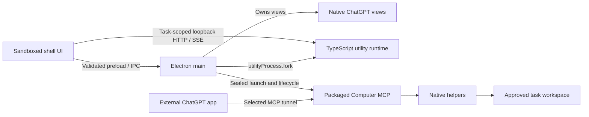
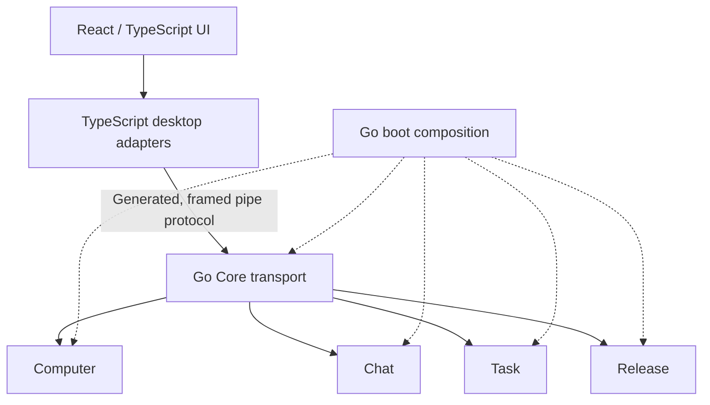

# Architecture

Farol is being migrated incrementally. This page separates the **running
TypeScript/Electron system** from the **accepted Go/React target**. See
[current status](status.md) for the exact release and source snapshot.

## Running desktop

The published beta and current desktop composition use an Electron main process,
a sandboxed TypeScript shell renderer, native `WebContentsView` browser surfaces,
and one Electron utility process. The utility owns Chat application state and a
loopback HTTP/SSE endpoint; main owns desktop/browser lifetimes and composition.
Computer MCP is a separately launched, sealed app-owned process reached through the
selected tunnel. Native file, shell, and update helpers still include Python.

The product launches the bundled Electron runtime, rather than an ambient Node
executable. Main owns exact child shutdown. Closing the last window disposes its
views but keeps the app/utility alive; reopening restores one window. Normal Quit
performs bounded drain. Unexpected utility death produces an explicit failed state
while retaining the shell for diagnosis.

The SSE stream is bounded and delivery-aware. Capacity pressure can discard only
acknowledged events. Exhausting an unacknowledged task window fails that task with
`EVENT_STREAM_CAPACITY_EXCEEDED`; it does not terminate unrelated tasks.

## Accepted migration target

- **React + TypeScript:** Farol-owned UI.
- **Plain TypeScript:** Electron, preload, Browser, Responses/SSE, IPC, and MCP
  adapters.
- **Go:** backend policy, application state, orchestration, and native execution.

This diagram is the target. The accepted source currently adds the Go Core bridge
and Computer read/list foundation. Production `farol serve` registers no Computer
implementation. Disposable test startup injects Computer for native-read protocol
coverage. The desktop does not yet select this Go executor; React and the other Go
modules are not made active by their planned layout.

Switch one capability at a time and remove its active TypeScript/Python duplicate
only after accepted routed parity. A green foundation test cannot qualify an
installed route. The [Desktop/Core reference](desktop-core.md) documents the current
pipe checkpoint.

## Product module ownership

| Go target | Owns                                                                        | Transitional source                                 |
| --------- | --------------------------------------------------------------------------- | --------------------------------------------------- |
| Computer  | Workspace authority, files, commands, native processes, and effect receipts | `src/modules/computer/` and native helpers          |
| Chat      | Turn, conversation/stream state, browser ports, and continuity              | `src/modules/chat/`                                 |
| Task      | Coding-task delegation and native task lifecycle                            | Coding-task behavior currently in Chat/Agent slices |
| Release   | Package/update policy, installation, and recovery                           | `src/modules/release/`                              |

`Turn` belongs to Chat. Browser, Responses/SSE, IPC, and MCP are adapters, not
additional product modules. Core owns the shared schema/transport boundary and
composition contracts, not filesystem permission policy or module effect journals.

New desktop source belongs under `apps/desktop/`. Existing TypeScript stays under
`src/` until its slice switches. Root `boot/` composes Go; `src/boot/` composes the
remaining TypeScript runtime. The separate compiler roots cover both desktop trees.

## Dependency rules

Pure domain/application layers depend on values and consumer-owned ports. They do
not perform filesystem/network operations, import host APIs, read ambient clocks,
or locate services globally. Infrastructure implements the ports; boot injects
concrete implementations and owns lifetimes.

| Boundary           | TypeScript under `src/`                                                     | Go target                                                                                                      |
| ------------------ | --------------------------------------------------------------------------- | -------------------------------------------------------------------------------------------------------------- |
| Published surface  | `contract`: boundary DTOs/schemas without app/domain implementation imports | `contracts/<feature>`: thin owning facade that delegates to its app with independent DTOs and explicit mapping |
| Neighbor access    | Consumer `infra/peer` to neighbor `contract`                                | Consumer `infra/peer` to neighbor `contracts`                                                                  |
| Forbidden crossing | Neighbor domain/app/infra and executable hosts                              | Neighbor internals, infrastructure leakage, boot/host imports into contracts                                   |
| Composition        | `src/boot/`                                                                 | Root `boot/`                                                                                                   |

The Go facade rule does not change the legacy TypeScript DTO-only contract rule.
Import gates enforce dependency edges. Review still verifies facade delegation,
independent DTO signatures, no implementation aliases, and explicit conversion;
an import check alone does not prove those properties.

Kernel infrastructure requires at least two real consumers with identical
semantics. Shared implementations own no mutable cross-consumer singleton. No Go
module imports kernel infrastructure; boot injects its ports. The existing
TypeScript clock is shared by Chat and Computer through separate injected instances.
Generic SSE framing is transport code under `src/pkg/sse/`, not kernel policy.

## Authority and unknown outcomes

Computer approval and a task-derived `TaskGrant` are both required. Delegation may
preserve or narrow the task grant; prompt text never enlarges it. Current policy,
physical roots, exclusions, expiry, and exact request correlation are checked at
boundaries and again before disclosure.

Each module owns durable intent before its effects and exact-key recovery. Core
has no generic operation journal. An acknowledgment loss, malformed response, or
unconfirmed cleanup remains unknown, without automatic resubmission, replacement
child, fallback provider, or executor switch.

Model and Product Agent are explicitly disabled in the running desktop. Source
seams and synthetic child tests are separate from enabling a product route.
[Model identity](model-routing.md), [Computer](computer-parity.md), and
[persistent task reference](persistent-chat-handoff-parity.md) define those limits.

## Browser overlays and isolation

Electron composites a native child view above renderer HTML. Main therefore hides
the selected browser view while Setup or a shell overlay is open, then restores it
on close. Main derives bounds from closed layout states; renderer-provided pixels
are not accepted. [Desktop design](design.md) owns the interaction rationale.

The visible app name is Farol, while existing `local.farol.next.preview`, state roots,
partitions, process names, and receipt schemas remain compatibility boundaries.
Farol Dev has its own profile/connector. Neither environment borrows the older
product's browser state or installed `codex-chatgpt-web` identity.

[resources.json](../resources.json) records current resource ownership. It includes
the explicitly selected Computer tunnel and GitHub updater; native Agent and login
item ownership remain absent. A previous statement that all integrations were
absent no longer describes this source.

## Enforcement and evidence

[TypeScript architecture tooling](../tooling/check-architecture.mjs) rejects invalid
imports, dynamic loaders, cycles, unclassified source, and forbidden UI/host edges.
[Go tooling](../tooling/check-go-architecture.mjs) enforces the accepted Go imports.
`task test:core` includes generation, race/vet, protocol, and bridge compilation;
`task ci:fast` adds the complete deterministic source gate.

Source tests, native temporary-workspace tests, app fixtures, packaged acceptance,
and live provider/installed behavior are different claims. [Testing](testing.md)
explains how reports keep those boundaries visible.

---

[Documentation index](README.md) · [Project overview](../README.md)
