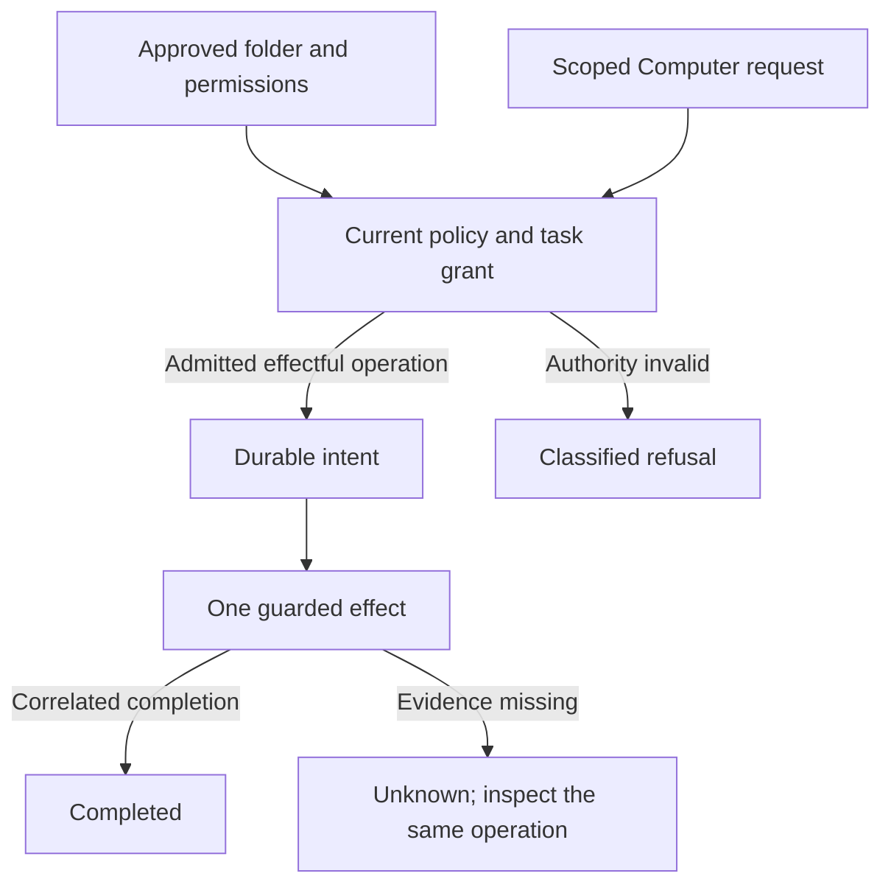

# Authority and recovery

A folder selection, a model's request, and a completed effect are different facts.
Farol keeps the authority for each operation explicit and retains uncertainty
until the owning route has correlated evidence.

## Authority and unknown outcomes

Computer approval and a task-derived `TaskGrant` are both required. Delegation can
preserve or narrow the task grant; prompt text cannot enlarge it. Current policy,
physical roots, exclusions, expiry, and exact request correlation are checked at
boundaries and again before disclosure.

Effectful operations persist their intent before execution. The owning module
keeps its effect/recovery record; Core has no generic operation journal. A lost
acknowledgment, malformed response, or unconfirmed cleanup remains unknown.

This view describes effect admission and evidence; it does not enable a disabled
provider/task route or grant an external account permission.

## Why observation cannot authorize another effect

A timeout says the observer stopped waiting. It does not establish that a file was
unchanged, a command never started, a Send never happened, or a native child ended.
Reissuing work under a new identity could create a second effect while hiding the
first. Recovery therefore remains bound to the original operation and route.

Cancellation and cleanup also have separate evidence. A root-process exit or signal
submission cannot prove that detached descendants are gone. The
[Computer reference](../reference/computer/capabilities.md) records the exact
process-group and detached-cleanup limits.

## Context does not renew authority

A retained ChatGPT conversation, summary checkpoint, or observed native task can
carry useful context. None renews a Computer grant or proves provider delivery.
The current request still needs its own scope, lineage, and readiness checks.

The Farol model-provider route and Product Agent are disabled in this source.
Their names, DTOs, and test seams do not bypass those gates. See
[status](../reference/status.md) and [model identity](../reference/protocols/model-identity.md).

## Related contracts and actions

- [Change folder access](../guides/folder-access.md) for the user action.
- [Recover an unknown outcome](../guides/troubleshooting.md#an-operation-has-an-unknown-outcome)
  for the existing operation.
- [Workspace context](../reference/computer/workspace-context.md) for bounded reads,
  instructions, and coverage.
- [Native task reference](../reference/tasks/native-tasks.md) for exact admission,
  observation, and terminal evidence.
- [Installed updater](../reference/updates/runtime.md) for update admission and recovery.

---

[Architecture](README.md) · [Documentation](../README.md)
