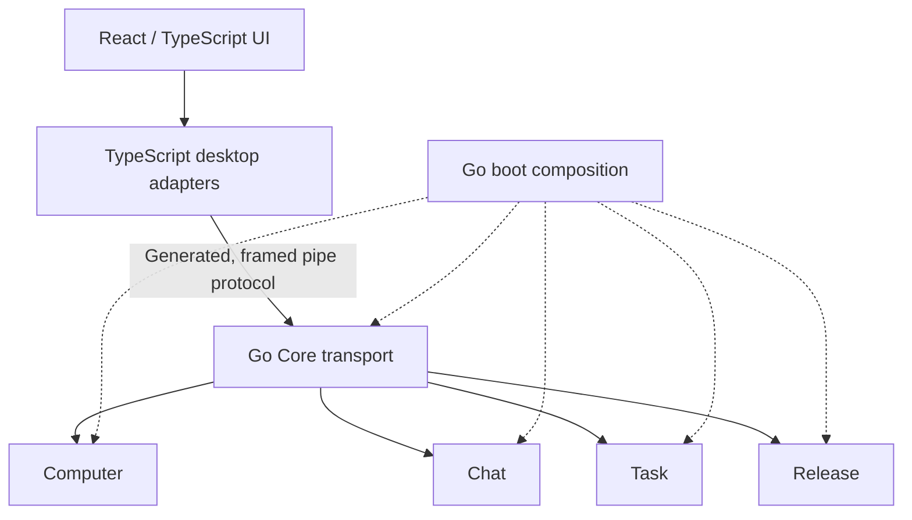

# Go and React migration

The architecture below is the accepted target. [Current status](../reference/status.md)
names what the published beta and accepted source actually implement.

## Accepted migration target

- **React + TypeScript:** Farol-owned UI.
- **Plain TypeScript:** Electron, preload, Browser, Responses/SSE, IPC, and MCP
  adapters.
- **Go:** backend policy, application state, orchestration, and native execution.

This diagram is the target. The accepted source currently adds the Go Core bridge
and Computer read/list foundation. Production `farol serve` registers no Computer
implementation. Disposable test startup injects Computer for native-read protocol
coverage. The desktop does not yet select this Go executor; React and the other Go
modules are not made active by their planned layout.

Switch one capability at a time and remove its active TypeScript/Python duplicate
only after accepted routed parity. A green foundation test cannot qualify an
installed route. The [Desktop/Core reference](../reference/protocols/desktop-core.md) documents the current
pipe checkpoint.

## Product module ownership

| Go target | Owns                                                                        | Transitional source                                 |
| --------- | --------------------------------------------------------------------------- | --------------------------------------------------- |
| Computer  | Workspace authority, files, commands, native processes, and effect receipts | `src/modules/computer/` and native helpers          |
| Chat      | Turn, conversation/stream state, browser ports, and continuity              | `src/modules/chat/`                                 |
| Task      | Coding-task delegation and native task lifecycle                            | Coding-task behavior currently in Chat/Agent slices |
| Release   | Package/update policy, installation, and recovery                           | `src/modules/release/`                              |

`Turn` belongs to Chat. Browser, Responses/SSE, IPC, and MCP are adapters, not
additional product modules. Core owns the shared schema/transport boundary and
composition contracts, not filesystem permission policy or module effect journals.

New desktop source belongs under `apps/desktop/`. Existing TypeScript stays under
`src/` until its slice switches. Root `boot/` composes Go; `src/boot/` composes the
remaining TypeScript runtime. The separate compiler roots cover both desktop trees.
---

[Architecture](README.md) · [Documentation](../README.md)
