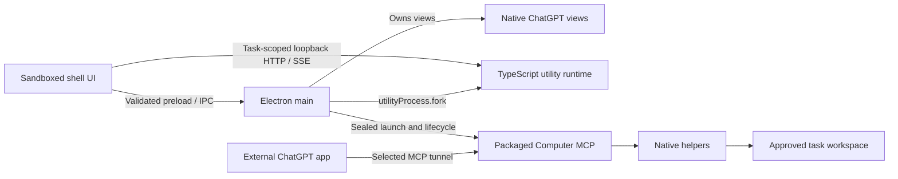

# Runtime architecture

Understand the processes and lifetimes in the running TypeScript/Electron desktop.
For the planned backend and UI switch, read [migration](migration.md).

## Running desktop

The published beta and current desktop composition use an Electron main process,
a sandboxed TypeScript shell renderer, native `WebContentsView` browser surfaces,
and one Electron utility process. The utility owns Chat application state and a
loopback HTTP/SSE endpoint; main owns desktop/browser lifetimes and composition.
Computer MCP is a separately launched, sealed app-owned process reached through the
selected tunnel. Native file, shell, and update helpers still include Python.

The product launches the bundled Electron runtime, rather than an ambient Node
executable. Main owns exact child shutdown. Closing the last window disposes its
views but keeps the app/utility alive; reopening restores one window. Normal Quit
performs bounded drain. Unexpected utility death produces an explicit failed state
while retaining the shell for diagnosis.

The SSE stream is bounded and delivery-aware. Capacity pressure can discard only
acknowledged events. Exhausting an unacknowledged task window fails that task with
`EVENT_STREAM_CAPACITY_EXCEEDED`; it does not terminate unrelated tasks.

## Browser overlays and isolation

Electron composites a native child view above renderer HTML. Main therefore hides
the selected browser view while Setup or a shell overlay is open, then restores it
on close. Main derives bounds from closed layout states; renderer-provided pixels
are not accepted. [Desktop design](desktop-design.md) owns the interaction rationale.

The visible app name is Farol, while existing `local.farol.next.preview`, state roots,
partitions, process names, and receipt schemas remain compatibility boundaries.
Farol Dev has its own profile/connector. Neither environment borrows the older
product's browser state or installed `codex-chatgpt-web` identity.

[resources.json](../../resources.json) records current resource ownership. It includes
the explicitly selected Computer tunnel and GitHub updater; native Agent and login
item ownership remain absent.
---

[Architecture](README.md) · [Documentation](../README.md)
