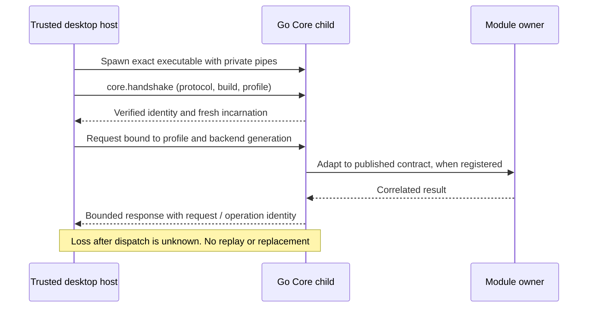

# Desktop/Core protocol

**State:** additive Go source foundation. The published desktop still uses its
TypeScript backend. Production `farol serve` leaves Computer unavailable;
[test startup](../../../tests/native/core/read.go) injects a disposable Computer owner.
See [status](../status.md) and [architecture](../../architecture/README.md).

## Source map

| Path                                                                           | Owner                                                          |
| ------------------------------------------------------------------------------ | -------------------------------------------------------------- |
| [api/desktop/v1/schema.json](../../../api/desktop/v1/schema.json)              | Canonical method metadata and independent wire DTOs            |
| [Desktop client](../../../apps/desktop/bridge/client.ts)                       | Trusted host client, framed decoder, generated TypeScript wire |
| [Go wire](../../../gen/desktop/v1/wire.go)                                     | Generated Go wire                                              |
| [Go transport](../../../transport/desktop/server.go)                           | Go server and published-contract adapters                      |
| [boot](../../../boot/application.go) and [command](../../../cmd/farol/main.go) | Backend composition and executable                             |

Only the trusted desktop host uses the pipe client. React/UI and remote browser
pages do not receive that client or direct pipe access. Root boot owns executable
selection, build provenance, composition, and lifetimes; Core supplies no alternate
filesystem policy.

## Generate and verify

```sh
node tooling/generate-desktop-wire.mjs --check
task test:core
npm test -- tests/contract/computer-core.test.ts
```

The generator uses the repository's locked Prettier and Go formatter. After an
intentional schema change, run it without `--check` and commit both generated peers.
Each embeds the schema SHA-256. `farol-wire/2` is the source generator format;
the current on-wire protocol is **1.0**. These versions have separate meanings.

`task test:core` checks generation/import drift, Go race tests/vet, the real
Desktop wire process contract, and strict TypeScript bridge compilation. It also
checks a transitional nested Go module when present. The focused Computer contract
command runs the Darwin disposable native-read route. These checks do not prove an
installed desktop executor or live provider.

For a development executable:

```sh
mkdir -p _output/tmp
go build -o _output/tmp/farol ./cmd/farol
```

Its command mode is `serve --profile <id>`, with inherited stdin/stdout pipes.
Stdout is framed protocol, not a human CLI. `boot.BuildID` defaults to `development`
and is linker-bound for an accepted build. A client cannot override it.

## Handshake and lifetime



Each process generates a fresh 128-bit incarnation. The handshake verifies expected
build/profile and compatible protocol, then supplies the context for later requests.
It proves backend identity, not Computer workspace authority.

The server owns closable pipe endpoints, closes them once on terminal return, and
passes its context to handlers. Cancellation closes the same endpoints to interrupt
idle reads or blocked writes. Module journals still decide whether an OS/provider
effect ended.

Owned-client fatal cleanup closes admission and the child's input, observes its
terminal state, and bounds stopping that exact child. Borrowed-client close only
detaches that wrapper's listeners and rejects its requests; it does not stop or alter
the owner's child. Signal submission alone is not termination evidence.

There is no endpoint-discovery service, global profile lock, automatic restart, app
installer, or MCP socket attachment supplied by this checkpoint.

## Wire admission

| Property                  | Current bound                                                                   |
| ------------------------- | ------------------------------------------------------------------------------- |
| Frame                     | Four-byte unsigned big-endian length, then 1–1,048,576 UTF-8 JSON bytes         |
| JSON depth                | At most 32                                                                      |
| Connection attempts       | At most 4,096 complete frames, including malformed/duplicate requests           |
| Client in-flight requests | At most 32, with writer backpressure admission                                  |
| Request ID                | Opaque ASCII string, 1–128 characters: letters, digits, `.`, `_`, `:`, `/`, `-` |

Duplicate keys, invalid UTF-8, unpaired escaped UTF-16 surrogates, trailing JSON,
batches, unknown envelope fields, and numeric request IDs are rejected. Valid Unicode
pairs, literal escapes, and an explicitly named U+FFFD stay distinct. An invalid or
truncated frame ends the connection; diagnostics use stderr and are byte-bounded.

Responses preserve exact request/operation/context correlation with `ok`,
`unavailable`, `unsupported`, `refused`, or `unknown`. Unknown methods are JSON-RPC
faults. Known unregistered capabilities are unavailable. Operation status is
unsupported until its module owner supplies authoritative retained state.

Method metadata classifies read versus effect. Effects require an operation ID;
reads reject one. Core registers no effects and owns no generic journal. Unknown
or oversized owner output is contained without replay. Limits require a coordinated
implementation/version change; regeneration alone cannot widen them.

## Disposable Computer read checkpoint

The typed `computer.workspace.read` adapter maps generated wire DTOs to Computer's
independent published contract and validates exact correlation. Identity includes
owner/session/task/participant/turn/call/workspace/path. Task epoch, generation,
byte counts, and page offsets/sizes are uint64 decimal strings, avoiding JavaScript
precision loss. Range length is a bounded integer, 4–262,144.

Trusted startup supplies roots, repositories, clock, and approval. Requests carry no
root, grant, trusted home, or revocation command. Computer retains authority checks,
descriptor-relative containment, UTF-8 windows, and disclosure policy. Its existing
safe offset limit is not widened by a lossless wire number.

A classified refusal preserves its code/source and `retry: never`. Complete JSON
escape expansion is measured before framing: a native result exceeding the pipe
budget becomes `refused` / `output_bound`, without content or a second read.

The [Computer route tests](../../../tests/contract/computer-core.test.ts) run an actual Go
child and temporary physical workspace through the actual TypeScript Client. They
cover full/ranged UTF-8, values beyond JavaScript precision, root escape, post-read
revocation, malformed Unicode, output expansion, stale generation, production
unavailability, and lost response without replay. A synthetic native-race refusal
checks code/source mapping; Computer's own filesystem tests own real changed-file
proof. No production permission persistence or installed Go cutover is claimed.

---

[Protocols](README.md) · [Documentation](../../README.md)
