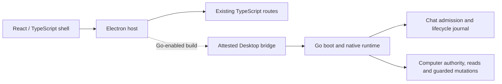

# Historical README: 9 October 2026

Preserved from source `75b15c789b7c5c0dd83bf4bd38eb6d2c8520a3eb` during the documentation reorganization on 14 October 2026. The original text below describes its dated evidence, tools and proposed capabilities; use [current status](status.md) and [Start](../start/README.md) for user guidance. Relative links have been rebased; historical claims and section names are retained.

## Original README

Farol connects ChatGPT to folders you choose on your Mac. Its desktop browser,
Computer access controls and operation status keep workspace access explicit.
**Farol Dev** uses a separate profile and connection from the installed app.

[Using Farol](../../docs/owner-preview.md#setup-inside-the-app) ·
[Development](#develop-from-source) · [Architecture](#source-architecture) ·
[Documentation](../../docs/README.md)

## Status and scope

Farol is an **owner beta for macOS on Apple Silicon**. This page describes the
current source integration tree. Local `main` contains the React/Go cutover and
later reliability and UI checkpoints; source integration does not update the
installed product or complete final release acceptance. The following observations
are dated **9 October 2026**.

| State                        | Scope                                                                                                                                                                                                                                                                                                                                             |
| ---------------------------- | ------------------------------------------------------------------------------------------------------------------------------------------------------------------------------------------------------------------------------------------------------------------------------------------------------------------------------------------------- |
| Installed slot               | `0.2.0-owner.beta.3`, ARM64 build `17`, source `24cc7c32`, at `$HOME/Applications/Farol.app`. Its on-disk manifest is Go-enabled schema 4. The unsigned beta predates current renewal/transport changes. Slot metadata does not prove a new installed runtime or reliability acceptance.                                                          |
| Published binaries           | beta3/build17 and beta4/build18 are published in `legrch/farol`. Published bytes remain immutable. A downloaded beta4 is distinct from the installed beta3; the normal N→N+1 update remains unqualified. Historical assets remain in their recovery context.                                                                                      |
| Source checkpoints           | Local `main` integrates the selected Home/wizard, retained ChatGPT presentation, current-authority renewal, bounded transport recovery and exact Task read-selection publication. Scoped tests/reviews apply to their exact ranges. Full-range source, native, package and installed acceptance remain separate gates.                            |
| Ordinary Dev evidence        | Saved-profile source `09d3d6c9`, Go build `6fb6b8cc…`, serves actual external catalogue/bootstrap/list/read/search, guarded file changes and original durable outcome observation across normal Quit/reopen. Its existing connection is held for the real twelve-hour renewal witness. Later source changes are not loaded into that running Dev. |
| UI evidence                  | Native Home/navigation, Review Setup, workspace/credential draft cancellation, Sunrise DEV About and browser overlay/focus have bounded witnesses. Later Appearance, Activity and Sign-in changes have scoped renderer evidence; current-source normal/compact/theme parity still needs native acceptance.                                        |
| Remaining daily-driver gates | Actual elapsed renewal and current-source transport recovery, remaining native UI/Setup journeys, external Go Git/Shell/Task, final source/package acceptance, compatible app+state recovery and a real successor update remain open.                                                                                                             |

The Go cutover is incomplete. The `56ed3941` normal-entrypoint Dev candidate passed
a controlled React/Go two-turn Chat journey from the ordinary first-message form,
without a selected file or Computer grant, clean Quit, and a same-profile/build
restart. Home's Saved Chat answers view then discovered and read both original
results through the current Go owner. Useful output preceded completion; explicit
result ACK and Go settlement/release preceded Follow. The independent provider
counter remained at exactly two accepted Sends across both app lifetimes. Exact
repeated inspect/start commands returned retained results; a changed first prompt
was refused without another Send. Both children quit cleanly. This is synthetic native evidence, not live-provider,
installed, cross-build recovery or full cutover qualification. Earlier failed
profiles remain quarantined. See
the [controlled Chat witness](../../docs/desktop-core.md#controlled-normal-desktop-chat).

The earlier installed predecessor was observed on 6 October as `0.1.11-owner.beta.1`,
build `13`, source `8c09f4c7`, separately from the React/Go Dev. Its retained
completed `0.1.10` → `0.1.11` update is a distinct operation; it does not settle
an older outcome-unknown update. The installed slot has since advanced to beta3;
that transition does not qualify the next in-app update. Fresh installed lifetime,
active-operation, state and recovery checks are still required before another
replacement. The earlier
[packaged Go Settings delivery witness](../../docs/desktop-core.md#go-owned-settings-delivery)
remains evidence for its exact package, not for the installed predecessor.

## Use and installation

The Go-enabled owner beta exposes workspace catalogue/bootstrap, list/search/read,
explicitly enabled guarded file changes and retained mutation observation. Shell,
ordinary Git and coding tasks are not exposed by that route. Their source adapters
need separate authority and native qualification; Git history can expose older
excluded content and approved user Git settings. Activity and support export
retain content-free diagnostics.
The Farol Model route and Product Agent remain disabled.

The current Go integration selects the same backend through a private socket
for external MCP catalogue, bootstrap, list, read, search, connector verification,
write, edit and retained-result observation. Go owns authority, mutation intent
and retained outcome. The ordinary Dev has actual external read/search and file
mutation evidence, including normal Quit and cross-build reopening with the same
profile. Shell and coding tasks are not exposed by this Go route. The native
shell qualification currently fails its stronger hardlink-alias guard; HOME/Git
and descendant settlement also remain open. Explicit legacy launch fixtures
remain separate, and a failed Go launch never falls back to them. See the
[current Computer evidence](../../docs/computer-parity.md#current-go-dev-evidence)
and [connector contract](modules/computer/connector.md).

Current source uses the existing authority Store and Settings publication for
automatic renewal under unchanged owner consent. Bounded transport recovery
requires confirmed original lifecycle closure, current consent and settled
operation evidence; pending/unknown effects are never replayed. These source
checks do not establish real sleep/network recovery. The held Dev's elapsed
twelve-hour external test and a later installed witness remain open. The
owner-reported 9 October outage has no retained first refusal identifying its
cause, so it is not attributed to approval expiry.

The published 0.2 betas include an app ZIP and a release manifest carrying its
checksum. **First
installation by an external recipient from that ZIP is not currently documented
and qualified as a supported end-to-end workflow.** The first-recipient install
and adoption mechanism remains product implementation work. A manual app copy
does not establish an accepted updater baseline.

The documented owner workflow is:

1. Prepare [source development](#develop-from-source). From accepted clean
   committed source, build a verified packaged candidate with `task package`.

   Then `task run` verifies it again and opens an isolated launch snapshot without
   installing it.

2. Follow [local promotion](../../docs/owner-preview.md#optional-local-promotion--owner-action-only):
   inspect `task promote`, then explicitly choose its documented apply action only
   when the destination and receipt are absent. This creates
   `$HOME/Applications/Farol.app` and its verified installation receipt. Preserve
   an occupied slot through the [closed cutover](../../docs/product-cutover.md).
3. Open **Farol** and use **Setup** to choose folders, configure the tunnel and
   select the exact connected ChatGPT app. Embedded sign-in is optional for
   Computer-only use. The embedded connection check sends one message only when
   selected; the external manual check is a separate option.

This owner workflow does not qualify external ZIP installation. An established
installed baseline uses **Check for Updates…** and the
[documented update lifecycle](../../docs/installed-update-runtime.md). Closing the window
leaves Farol running; **Command+Q** quits it. See the [user guide](../../docs/owner-preview.md)
for access controls and recovery. Unknown outcomes are not permission to retry.

## Develop from source

The checkout contains the source, resources, tests and build tooling. Use macOS
ARM64, Node **24.20.0 or 26.7.0**, npm **11.19.0**, Go **1.26.2**, the `task` CLI
and Apple Command Line Tools. The complete source gate also requires `gitleaks`.
Build tooling verifies pinned compiler, SDK, dependency and native-helper bytes;
installing a similarly named toolchain does not satisfy those checks.

With the declared Node/npm pair on `PATH`, from the repository root:

```sh
npm ci --ignore-scripts --no-audit --no-fund
node node_modules/esbuild/install.js
node node_modules/electron/install.js
npm run check:toolchain
task dev
```

`task dev` uses the ordinary saved Farol Dev profile and requires the Go backend.
Place the separately approved local [Go input declaration](#declared-go-backend-inputs)
at `_output/go-build-inputs.json` (ignored by Git), or select an explicit absolute
file with `task dev -- --go-inputs=/absolute/path.json`. Missing, invalid or
unauthenticated inputs refuse the build; Dev does not silently start without Go.
The existing Go builder requires clean committed source. It verifies the SDK,
modules and source instead of downloading or trusting an arbitrary local `go`.
An ordinary `task dev` stops the previous Dev from this exact checkout/profile
before replacing dependencies or rebuilding shared outputs. It checks the private
run marker, executable, account, boot and precise native lifetime, allows 30 seconds
to stop, then forces that process once if necessary. Other profiles and installed
Farol are not stopped. A refused or uncertain lookup/signal blocks the build.
**Ctrl+C** stops what the launcher started and escalates automatically if it hangs.
Neither process disappearance nor forced stop means application work was drained:
retained UNKNOWN and interrupted-profile recovery guards still apply.
Dev is not a package candidate.
`task dev -- --check` validates and builds without launching or changing profiles;
`--fresh-review-profile` is a separate disposable review journey.

| Existing command        | Purpose                                                                                                                        |
| ----------------------- | ------------------------------------------------------------------------------------------------------------------------------ |
| `task test:unit`        | Unit/component selection across TypeScript, React and Go.                                                                      |
| `task test:integration` | Module, adapter, process and native tests, excluding the unit selection.                                                       |
| `task test:fast`        | Unit/component plus four explicitly selected browser-free integration files.                                                   |
| `task test:core`        | Generated wire/import checks, root and transitional nested Go race/vet checks, bridge tests and strict TypeScript compilation. |
| `task ci:fast`          | Complete deterministic source gate, including core, coverage, Hunt, output layout and secret scanning.                         |
| `task package`          | Build and verify a candidate from exact clean committed bytes.                                                                 |
| `task run`              | Verify the existing candidate against source and open its private launch snapshot.                                             |
| `task test:e2e`         | Separate packaged Electron checks with explicit display/focus requirements.                                                    |

The three scoped commands accept `-- --list` to show exact files, packages and
prerequisites without running tests. Their npm aliases use the same selector.
Selection follows reviewed behavior, including corrections to legacy folder names.
They require the declared Node and Go toolchains and installed dependencies; they
do not download tools or build a candidate. Full `task test` and `task qualify:live`
are still target contracts, not implemented aggregates. Existing `task test:e2e`
keeps its packaged Electron meaning. See the [testing policy](../../docs/testing.md).

The [repository checkpoint policy](../../AGENTS.md) permits targeted verification,
self-review and `git diff --check`, followed by an owned-only checkpoint commit.
Freeze a coherent integration candidate before `task ci:fast` and its risk-selected
independent review. Hunt requires clean committed source. A checkpoint preserves
work; it is not product acceptance. See [standalone build guidance](../../docs/standalone-build.md).

Hunt now uses the same Go-required `tooling/dev.mjs --check` producer and verifies
the source, input ledger, complete entry set and core artifact before recording
evidence. Consequently, `task ci:fast` also needs the separately approved inputs
at `_output/go-build-inputs.json`. The manual hosted standalone workflow does not
yet provision that declaration and its SDK/module inputs; a fresh hosted run is
not qualified. Missing inputs refuse the build rather than emit core-less output.
Local checks, native acceptance and package acceptance remain separate evidence.

### Declared Go backend inputs

The existing candidate command accepts an explicit local input declaration:

```sh
task package -- --go-inputs="$HOME/farol-build/go-inputs.json"
```

This is a source-supported build entrypoint, **not a production-qualified recipe**.
It requires clean committed source and a separately prepared declaration. The
JSON file must have schema `farol-go-build-inputs/1` and these fields:

- `toolchain`: canonical absolute SDK `root`, independently approved full-SDK
  `treeSha256`, `version: "go1.26.2"`, `goos: "darwin"`, and `goarch: "arm64"`
  for the current desktop target. A freshly measured digest is not approval.
- `moduleInputs`: explicit entries for `golang.org/x/sys` `v0.35.0` and
  `golang.org/x/text` `v0.28.0`, each with `modulePath`, `version`, `zipPath`,
  `modPath`, `contentRoot` and optional `zipHashPath`. Supply canonical absolute
  local paths; authentication uses committed `go.sum` and fails on missing inputs.

See the [input parser](../../tooling/go-build-inputs.mjs) and
[backend builder](../../tooling/go-backend-build.mjs) for exact validation. The builder
embeds the backend declaration into the Electron host and emits build schema `4`;
packaging uses schema `7`. The low-level builder can still emit legacy schema `3`
without Go inputs, but the 0.2 candidate packager refuses that output before
package effects. The current desktop external Computer route requires the
backend and refuses its absence. For this integration line, supply the same
declared inputs to `task dev -- --go-inputs=<absolute-json-path>` or `task package`.
Both build paths still compile the separate Go archive helper; neither establishes
installed Go Computer acceptance.

`task package` remains the sole candidate producer. Its Go-enabled artifact needs
normal Electron/native/package qualification before use as an accepted product.
Direct execution inside `_output/package` is unsupported. Package creation,
installation, update/rollback and live provider qualification are separate steps.

## Source architecture

The Farol-owned shell is React + TypeScript. Electron and browser mechanics remain
plain TypeScript. The optional Go host is wired through trusted profile and artifact
checks:



The external connector has its own bounded Go execution owner and uses the
existing Computer authority Store in the same backend. It requires no fabricated
Chat or coding-task membership. `chat.turn` separately supplies admission for
Chat-owned Computer work. The native Chat owner
also composes a typed browser exchange, bounded result retention and conversation
methods. Controlled-peer tests through the normal Go CLI cover useful streaming,
the first Home-to-conversation binding, same-conversation follow-up and a lost
acknowledgement without another Send.
The normal host composes the browser pump and physical adapter. The controlled
native witness above exercises their real DOM path and React delivery. Production
control translations and output profiles remain unqualified; ordinary production
Chat and the external model route are unavailable. A tool-output continuation does
not establish support for a new user turn through the Responses adapter.

The selected Task facade also maps create, observe, exact dispatch status/result,
same-thread continuation, exact-session resume and retained progress into the
common framed protocol. Controlled in-memory boundaries exercise the real Task
service, Codex transport and Claude Host/Computer service chain, including useful
output before terminal, historical results and lost-ACK no-repeat behavior.
The Claude execution lease is selected only after Task admission. `NativeRuntime`
does not yet register these Task routes: trusted selection, native qualification
and real Codex/Claude journeys remain separate acceptance work.
Settings now retain the exact selected Codex thread and turn; legacy absent or
thread-only selections remain readable but cannot produce an exact read selection.
The same Computer publication carries that pair with its current Task source, and
Go copies both under the original withdrawal/unknown fence. This metadata performs
no provider read, issues no admission and does not activate an external Task tool.

| Location                                                                                                   | Ownership at this checkpoint                                                                                                                                                                                                               |
| ---------------------------------------------------------------------------------------------------------- | ------------------------------------------------------------------------------------------------------------------------------------------------------------------------------------------------------------------------------------------ |
| [`src/`](../../src/)                                                                                       | React shell under `src/ui/renderer/`, Electron/browser adapters, transitional services and composition.                                                                                                                                    |
| [`apps/desktop/`](../../apps/desktop/)                                                                     | Attested Go host, authority publication and generated Go/TypeScript wire bridge.                                                                                                                                                           |
| [`boot/`](../../boot/), [`cmd/farol/`](../../cmd/farol/), [`transport/desktop/`](../../transport/desktop/) | Go composition, entrypoint, native profile lifetime and framed protocol.                                                                                                                                                                   |
| [`modules/computer/`](../../modules/computer/)                                                             | Authority, filesystem and process services. Native ingress selects catalogue/bootstrap/list/read/search and guarded write/edit/observe; external verification uses the same Go owner. Shell and other capabilities need their own cutover. |
| [`modules/chat/`](../../modules/chat/)                                                                     | Turn, queue, admission, browser exchange and bounded retained results; controlled normal desktop Chat and authorized saved-answer reads across a clean same-build restart.                                                                 |
| [`modules/task/`](../../modules/task/)                                                                     | Coding-task lifecycle and provider adapters; shipping task-route qualification remains separate.                                                                                                                                           |
| [`modules/release/`](../../modules/release/)                                                               | Update/recovery, journal and identity/adoption preparation; the existing updater is still active.                                                                                                                                          |

Domain and application code use values and consumer-owned ports. Neighbors cross
published contracts through `infra/peer`; Go contracts map independent DTOs and
delegate to their own module. Root `boot/` composes Go and `src/boot/` composes the
remaining TypeScript. Core does not become a second authority or journal owner.
The exact local `c1d67c0` package passed the bounded normal-main startup/reopen
journey in [Desktop/Core evidence](../../docs/desktop-core.md#normal-startup-and-empty-profile-reopen-candidate).
Component and source checks alone do not establish packaged or installed behavior.

The [documentation index](../../docs/README.md) links module contracts, migration limits,
installation and verification. Unsigned distribution, remaining Python helpers,
first-recipient installation and normal Go product qualification remain open.
