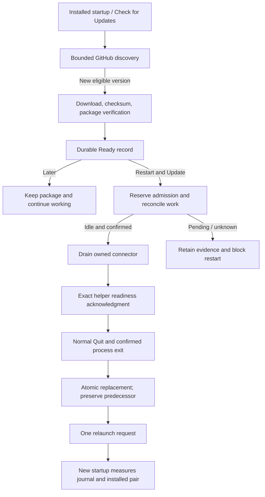

# Installed updater lifecycle

**State:** current TypeScript/native-helper implementation. It applies only to the
exact **`$HOME/Applications/Farol.app`** slot, existing product profile, eligible
owner-beta build, and measured accepted installation evidence. Temporary `task run`
snapshots and arbitrary copied apps cannot replace this slot. See
[installation](../../start/installation.md) for the normal path and [status](../status.md) for
qualification limits.

## Normal update

Automatic startup/six-hour discovery and manual checks use the same
[release contract](release.md). Later does not enter drain. An
unknown download, ready write, or helper handoff stays fenced across restart;
startup does not dispatch a replacement operation.

## Accepted baseline and admission

Before discovery and preparation, the measured installed tree must match accepted
package evidence. Initial promotion supplies its genuine private receipt; later
updates bind reconciled source/target receipts and journals. Labels/version alone
cannot authenticate modified installed bytes. Missing, redirected, malformed, or
mismatched evidence blocks preparation.

Explicit restart reserves configuration/task admission, Computer mutation gates,
and the kernel promotion lease. It reads durable Desktop obligations before stopping
clients and again after drain. Pending edit delivery, unknown mutation/shell records,
dispatch locks, unreadable/changing journals, and incomplete task intents block restart.
Open ChatGPT documents require explicit closure.

A configured idle connector can be drained while retaining its saved route/folders.
Issued Codex tasks use exact read-only status; only terminal turns plus observed idle
threads qualify. Expired/unavailable/mismatched host admission is not idle. These are
bounded thread observations, not a global lock over unrelated native clients.

Connector/MCP/proxy shutdown must prove their owned lifetimes ended. The shared Codex
daemon is never stopped. Saved task route, credentials, selected app, and workspace
approval remain; reconnect after relaunch needs separate qualification and never
sends a verification challenge automatically.

## Download, preparation, and cleanup

Download intent durably binds producer PID/start and its staging directory before the
first request. A ready record binds the verified archive to one operation before
helper dispatch. The preparation phase durably names any accepted app copy.

Interrupted pre-helper staging can be reconciled only after exact producer exit,
unchanged installed source, absent helper/journal effects, and bound directory/content
checks. Legacy missing witnesses, live/unobservable processes, substituted paths, or
uncertain cleanup remain fenced. Reconciliation never redownloads or applies.

Accepted archive retention commits its ready record before disposing extraction.
Rejected/settled archives are reclaimed through checksum-verified no-follow descriptors;
truncating that bound descriptor avoids deleting a substituted pathname. Predecessor
apps, settings, and workspace state are not reclaimed.

Main copies/removes physical ASAR-containing trees with `original-fs`; trusted verifier
readback runs Node mode with ASAR disabled. Failure retains the unknown cleanup
obligation. Tests of synthetic verifier responses prove this physical boundary, not
package authenticity or an installed upgrade.

## Helper handoff and uncertainty

Only the bound helper acknowledgment permits normal Quit. Persist its actual PID on
spawn before sending program/request bytes, then enrich with observed process start.
A failed/unavailable start read stays null; no-PID by itself is not no-spawn proof.
An unknown handoff retains the same operation/child handle while the app is alive.

[The helper](helper.md) verifies normal Quit/drain, accepted pair,
and lease before atomic replacement. Its result and a relaunch request do not replace
new-startup installed readback.

A known pre-mutation refusal or `not_started` result can release admission only after
its exact negative launch/terminal proof and unchanged source/journal checks. Cleanup
intent is durable before copy reclamation. Lost proof or uncertain close stays unknown.
Once mutation admission must remain held, the runtime retains its handle/kernel lease
until process exit; returning unknown or closing the UI does not release it.

## Recovery and rollback

Startup observes the same journal and current/predecessor/staged/failed pair without
spawning a helper. A settled target may offer **Restart & Restore Previous Version**.
An interrupted eligible pair may offer **Restart & Finish Recovery** only after exact
original helper termination and physical reconciliation.

Restore/recovery has its own exact intent and helper PID witness, uses the same normal
Quit/admission protocol, and never invents a replacement operation after uncertainty.
A changed terminal journal plus measured running pair can reconcile an earlier intent.
A cancelled or rolled-back build is not automatically offered again. Journals and
companions remain retained; recovery does not delete workspaces/settings.

Normal Quit cancels this updater lifetime's HTTPS requests and waits through bounded
drain for cleanup or durable retention. Deadline expiry records unconfirmed updater
cleanup. A verified ready archive can remain after its UI closes.

## Historical closed repair

The retained [closed-preview-repair tool](../../../tooling/closed-preview-repair.mjs)
accepts **schema 5 only** for its historical preview slot. Its separate receipt is
not a normal promotion or GitHub-update receipt. Both matching terminal repair journal
and physical installed/predecessor identities are needed as historical baseline evidence.
It is not a current schema 6 installation command.

[Product cutover](../../maintenance/preview-cutover.md) owns retirement of that old layout and closed
recovery. Those tools do not fence concurrent startup of older bundles; a closed
exclusive maintenance window and exact result readback are required. That residual
race remains unqualified.

## Source and evidence

[Desktop composition](../../../src/apps/desktop/installed-update-runtime.ts),
[application updater](../../../src/modules/release/app/installed-updater.ts), and
[helper](helper.md) have source/disposable process/filesystem tests.
They do not prove public download, live installed replacement, LaunchServices startup,
configuration preservation, reconnect, or rollback on a user's actual installation.
Those require separate exact-package observations.

---

[Updates](README.md) · [Documentation](../../README.md)
