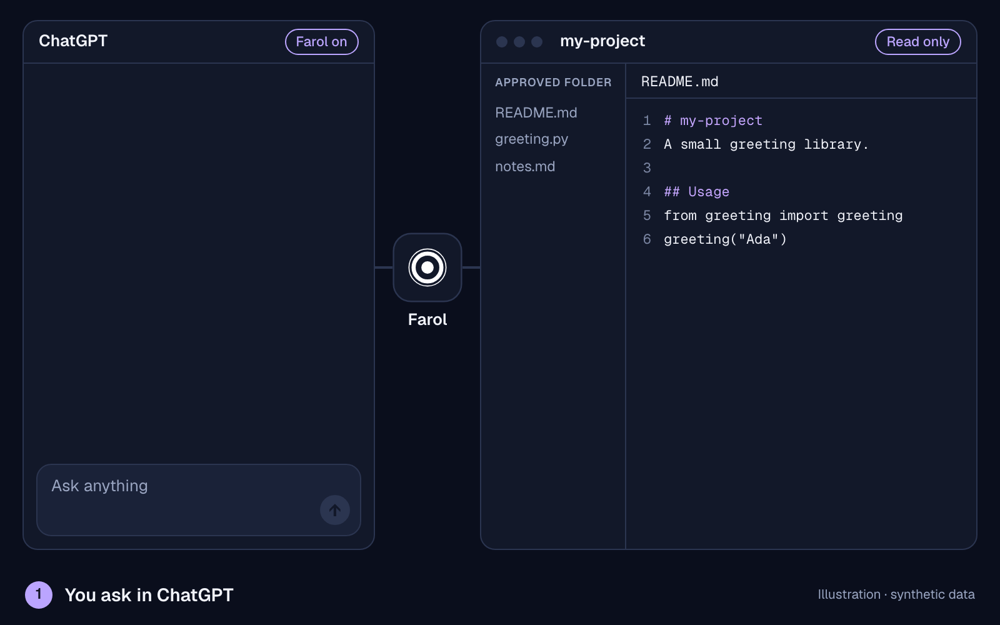
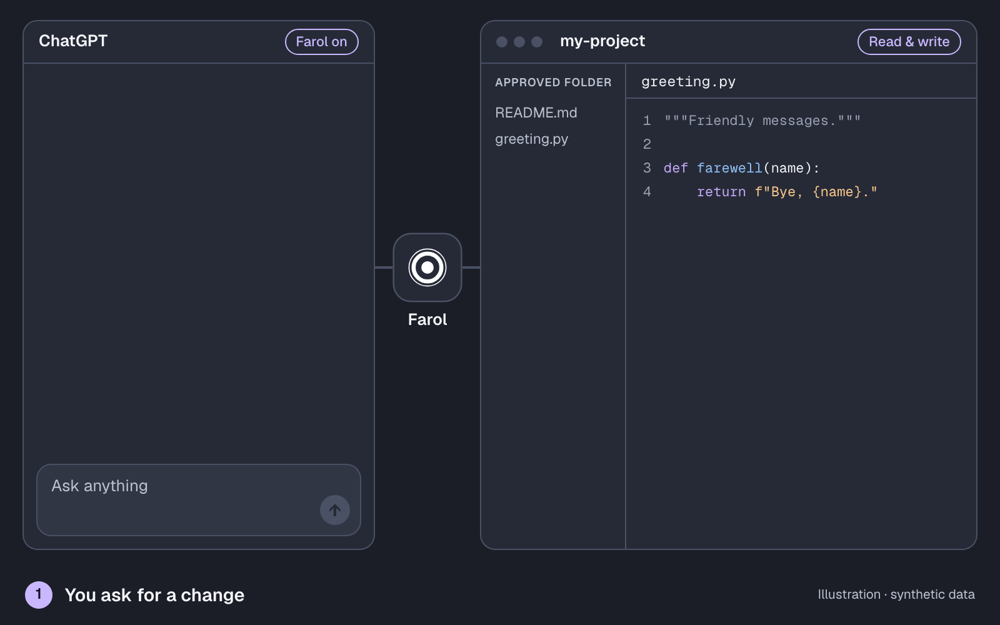

# What Farol does

Farol connects selected folders on your Mac to ChatGPT through a Secure MCP Tunnel. The desktop app owns your local folder grants and tunnel configuration. The ChatGPT plugin is the connection you select in a conversation.

## Watch the workflow

The example reads from a selected workspace and returns requested contents to ChatGPT. It illustrates the workflow with synthetic data, not a live session.

The edit example assumes an existing Read & write grant. Tool confirmations follow ChatGPT's settings. [Continue with the complete guide on the home page →](../../README.md#install-in-one-line)

## A small example

1. Choose a folder containing non-sensitive project notes in Farol.
2. Ask ChatGPT to list the approved workspaces and summarize a named file.
3. If you want an edit, review the proposed change and explicitly enable **Read & write** for that workspace when appropriate.
4. Ask for the specific change and inspect the result. Tool execution still depends on Farol's saved access, ChatGPT permissions and the available capabilities.

[Try this with a sample folder](first-workspace.md) before granting real project material. Keep the first trial read-only with Commands off.

## What is a workspace?

A **Farol workspace** is a local folder you approve. A **ChatGPT workspace** is your account or team's context in ChatGPT. They are different: the tunnel must be attached to the intended ChatGPT workspace, while local file access comes from Farol's folder grants.

New Farol workspaces start with **Read only**. **Read & write** allows supported guarded file changes. **Commands** is a separate setting shared across approved workspaces, not an independent sandbox for each folder.

## What can I use it for?

- **Find information:** list and search files inside an approved workspace.
- **Understand a project:** read selected files and ask ChatGPT to explain them.
- **Make a requested edit:** grant Read & write when needed, then check the actual change.

Local Shell and ordinary Git have evidence from qualified internal installations and selected toolchains. Do not infer availability for every public download, arbitrary hook or remote operation. Tasks, Agent workflows, Git SSH and PDF/image transfer are not general supported-capability claims. [Current status](../reference/status.md) separates those limits.

## What leaves the Mac?

Requested file contents and tool results can be returned to ChatGPT. Choosing a folder is therefore a sharing decision. Read-only prevents permitted file changes; it does not make the readable data private from ChatGPT. Avoid broad home-directory grants and review exclusions, repository history and hooks before allowing commands.

Farol's saved access and ChatGPT's tool-confirmation choices serve different purposes. Neither a successful connection nor a permissive ChatGPT setting expands your local folder grant. See [Best practices](../guides/best-practices.md) and [Privacy and security](../guides/privacy.md).

## What do I need first?

An accepted running Farol installation, an Apple Silicon Mac, and a ChatGPT workspace with the required connection features. The public build is unsigned and not notarized; the supported fresh-install and trusted-update path is still under qualification. Do not treat the setup animations as an installer or live acceptance evidence.

[Check installation status →](installation.md) · [Connect an existing installation →](first-connection.md) · [Start](README.md)
