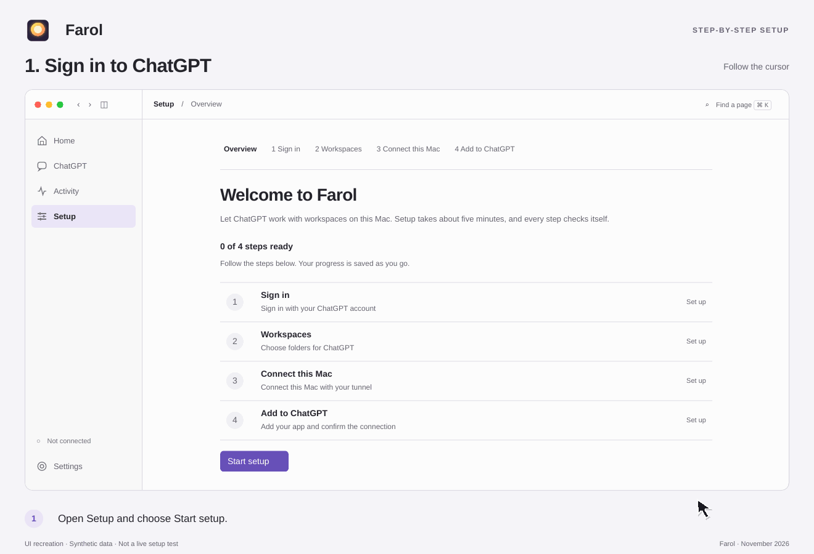
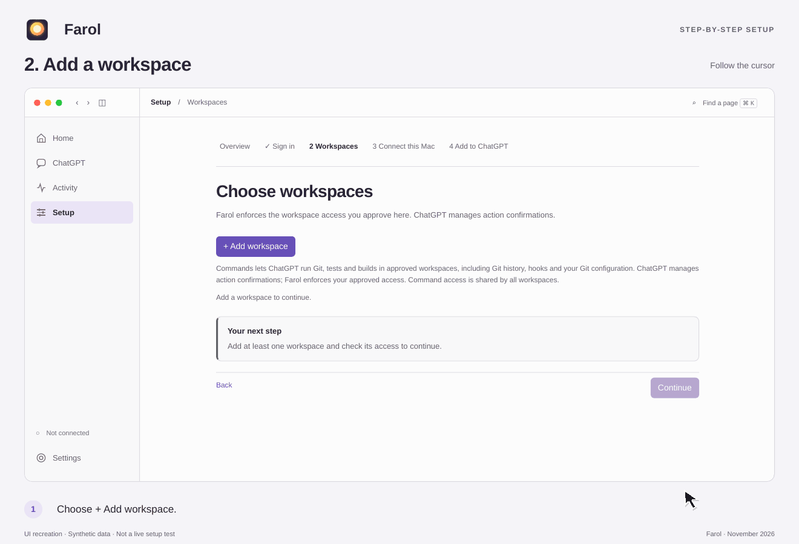
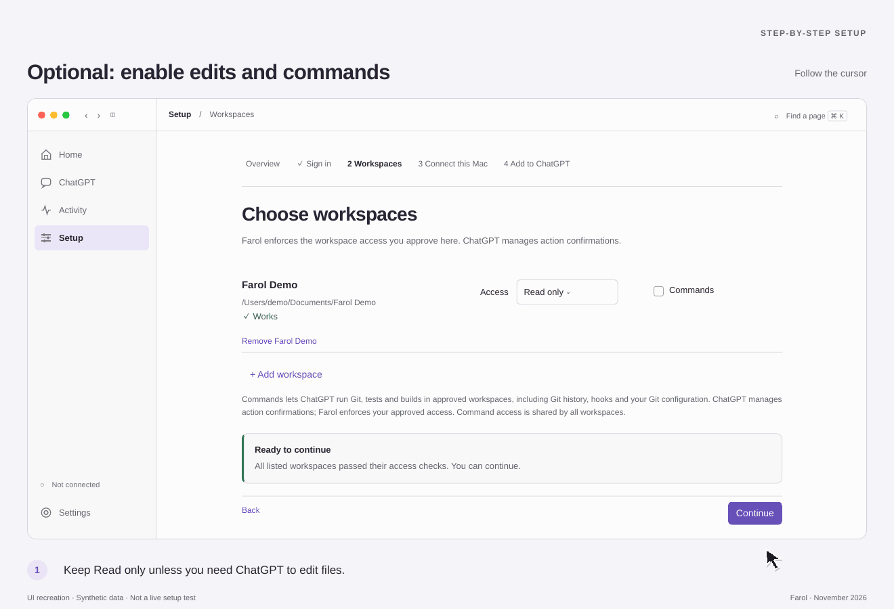
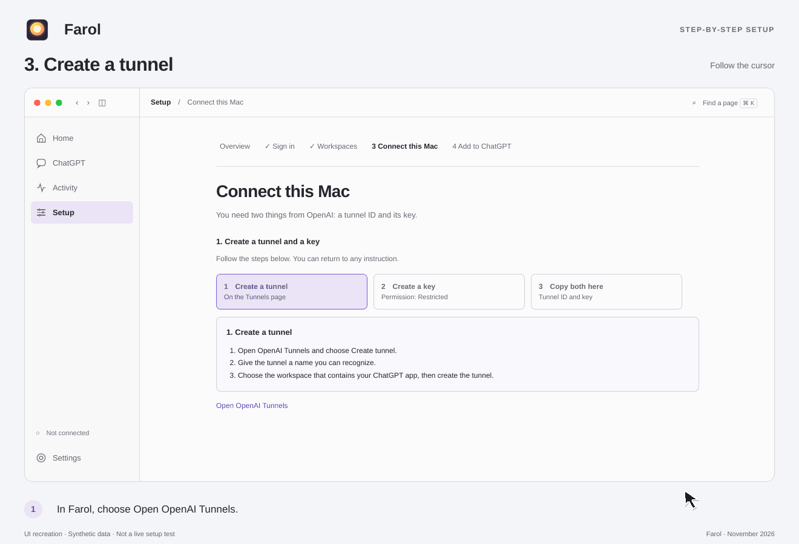
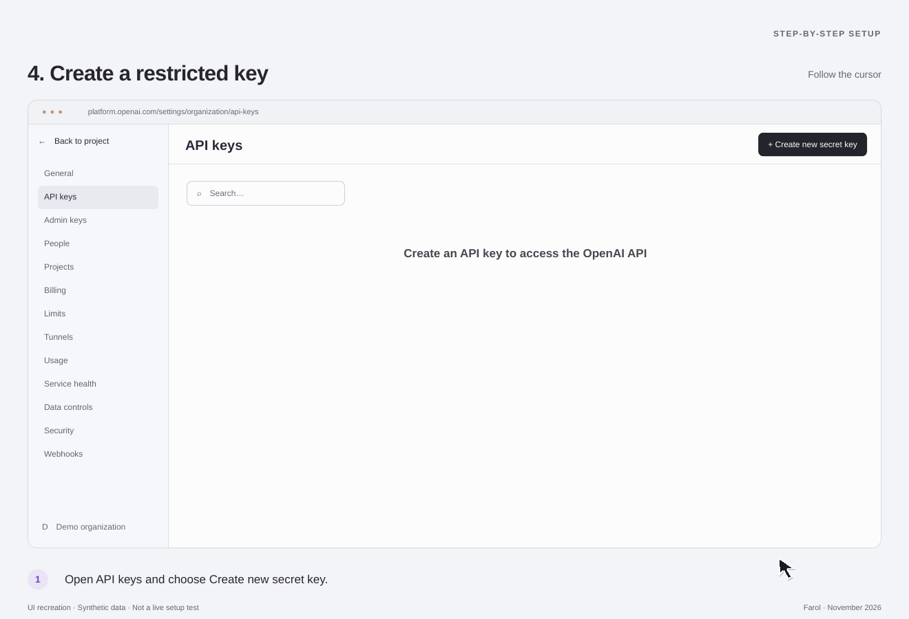
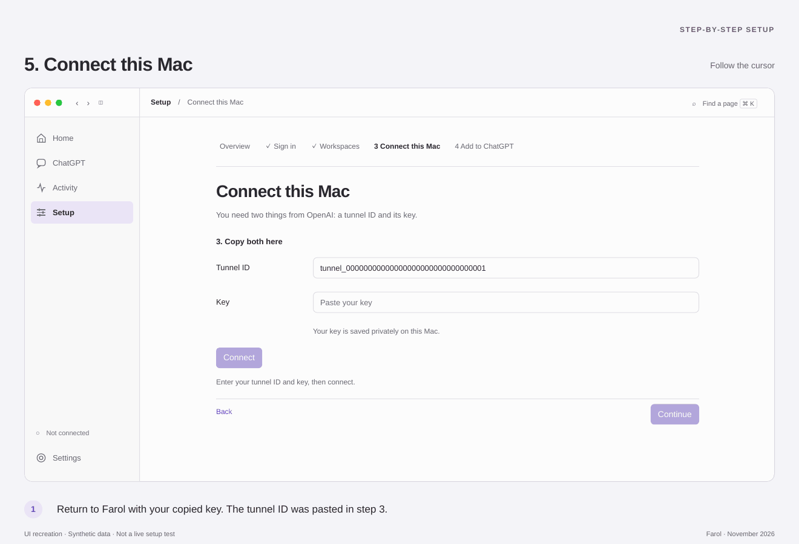
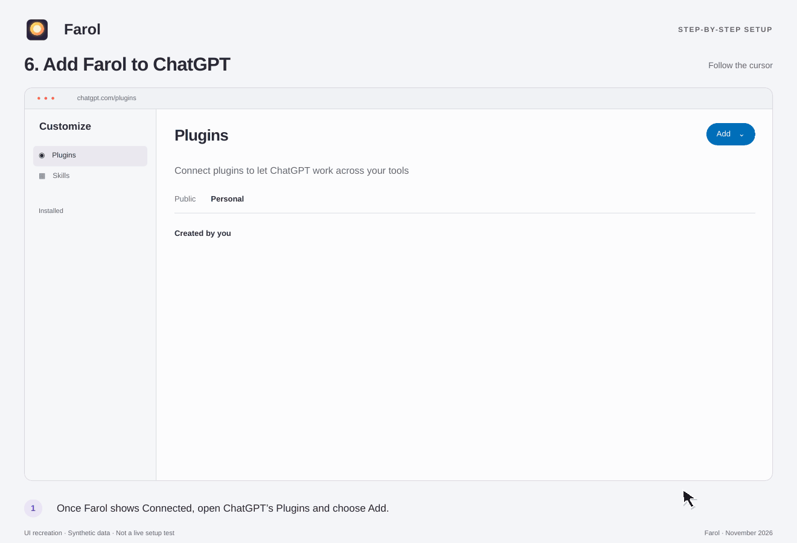
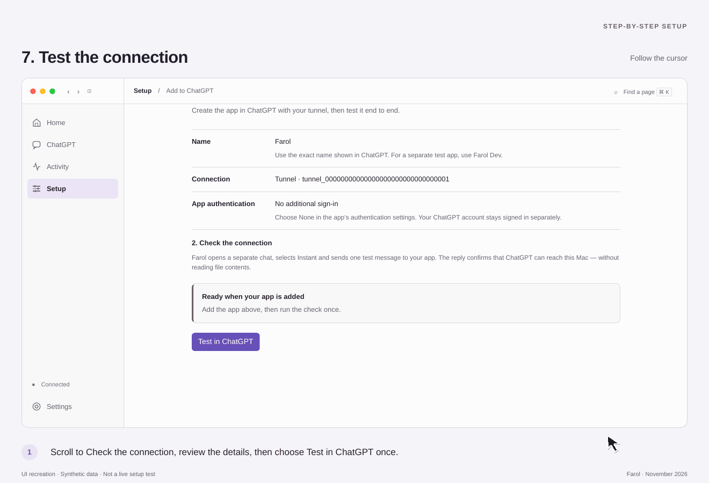

# Connect Farol to ChatGPT

[← Installation](installation.md) · **Setup** · [Next: your first workspace →](first-workspace.md)

Follow this guide from an accepted, running Farol installation. You will sign in, choose a folder, connect this Mac through a tunnel, and add Farol in ChatGPT. Finish by testing the connection, then try your first file request.

> **New to Farol?** Start with [Installation and requirements](installation.md). Public downloads do not yet have a qualified first-install procedure. These steps begin inside a running app; they do not install Farol.

The eight animations below recreate the UI with synthetic data. They are not screen recordings or live setup evidence. Screens and account-specific choices may differ. Every action is also explained in text.

[Prefer the complete guide on one page? Read the Farol home page →](../../README.md#install-and-connect)

## Steps

- [1. Sign in to ChatGPT](#1-sign-in-to-chatgpt)
- [2. Add a workspace](#2-add-a-workspace)
- [Optional: edits and commands](#optional-edits-and-commands)
- [3. Create a tunnel](#3-create-a-tunnel)
- [4. Create a restricted key](#4-create-a-restricted-key)
- [5. Connect this Mac](#5-connect-this-mac)
- [6. Add Farol to ChatGPT](#6-add-farol-to-chatgpt)
- [7. Test the connection](#7-test-the-connection)

## 1. Sign in to ChatGPT

1. Open **Setup → Start setup** and choose **Sign in** or **Open ChatGPT**.
2. Use your own ChatGPT account, then return to Setup. If confirmation is still needed, choose **Check sign-in**.
3. Wait for **✓ Sign-in checked**, then choose **Continue**. This does not yet grant local file access.

## 2. Add a workspace

1. In **Workspaces**, choose **+ Add workspace** and select a small, non-sensitive sample folder.
2. Review the path and saved **Read only** access. Wait for **✓ Works**; every listed workspace needs a current check.
3. Choose **Continue** when the checks are current. [Try a sample workspace](first-workspace.md) for a complete read-only exercise.

## Optional: edits and commands

Keep Read only and Commands off for the first reading exercise. If a later task needs changes, choose **Read & write** in the workspace row and wait for the saved access check. Review **Commands** separately: it is shared across approved workspaces, not a per-folder sandbox. The animation demonstrates optional changes; it is not a required setup step. See [Best practices](../guides/best-practices.md).

## 3. Create a tunnel

1. From **Connect this Mac**, choose **Open OpenAI Tunnels** in the intended Platform organization. Reuse an appropriate existing tunnel if you already have one.
2. For a new tunnel, fill **Name** and the required **Description**, review **Organizations**, and select the intended **ChatGPT workspaces**. A workspace may display as an ID. Review any optional security settings under your organization's policy.
3. Choose **Create** once and observe the result. Copy the complete tunnel ID from its row.
4. Paste that ID into Farol before copying the key, so the next Copy action does not replace your only copy of the ID. A Platform-organization-only tunnel may not be available in ChatGPT.

## 4. Create a restricted key

1. Open the API-key form and choose the intended project and expiration under your organization's policy. The available menus were not verified and are deliberately not illustrated.
2. Choose **Restricted**. Under **Tunnels**, select **Read** and **Use** only; leave unrelated permissions at **None**. “All selected” inside that selector means both Tunnels choices, not full-key access.
3. When the key is created, use **Save your key → Copy → Done**, then return to Farol. Keep the real key private. The visible demo key is invalid and must not be used.

Do not substitute a full-access or admin key. Never paste the key into a chat, repository, screenshot or support message.

## 5. Connect this Mac

1. Confirm the **Tunnel ID** is present and paste the key into Farol's masked **Key** field.
2. Choose **Connect** once. Wait for the existing result; do not resubmit while it is pending or unknown.
3. Continue after **✓ Connected**. This confirms the local connection, not the ChatGPT attachment. If Farol says **Key saved**, leaving the field empty retains it; do not create or paste a replacement just because the field cleared.

## 6. Add Farol to ChatGPT

1. Choose **Open ChatGPT Apps** in Farol. In the intended ChatGPT workspace, open **Plugins → Add → Add custom MCP server**. Reuse a plugin already attached to the same tunnel instead of duplicating it.
2. Set **Name** to the editable app name shown in Farol, **Connection: Tunnel**, the same **Tunnel ID**, and **Authentication: No authentication**. Read the risk disclosure and decide whether to accept it before choosing **Create as a plugin**.
3. Review the separate **Connect** dialog and data-sharing notice. Choose **Connect** once, wait, and find Farol in the plugin list.
4. Open **⋯ → Manage → Permission** to review **Permissions**. The animation leaves **Allow low-risk tools (Default)** unchanged.

The other choices are **Always ask**, **Allow read-only tools** (read without asking, but ask before changes), and **Allow all tools (Elevated risk)**. These are the UI descriptions, not guarantees for every call. Allow all tools is optional, requires an informed owner decision and is not necessary to follow this guide. [Compare the permission choices](../guides/best-practices.md#choose-chatgpt-permissions-deliberately).

## 7. Test the connection

1. Return to Farol and choose **Test in ChatGPT** once. It uses a separate ordinary chat with Instant and the exact app name saved for this tunnel.
2. Wait for the original test. **Back to setup** returns without sending again.
3. Choose **Start using Farol** after **✓ Everything works** and current workspace checks. A model reply or plugin chip alone does not establish this result. The check does not read file contents.

If a check is already current, continue without repeating it. The successful state in the animation is simulated; it is not proof that your own setup passed.

## If a step is interrupted

Observe the original result before another connection attempt, key change or verification message. **Back** reviews an earlier step without replaying an action. Follow [Recovery](../guides/recovery.md) for pending or unknown effects; do not widen access, delete state or choose another tunnel to clear uncertainty.

[Text connection guide](first-connection.md) · [Best practices](../guides/best-practices.md) · [Start](README.md) · [Next: your first workspace →](first-workspace.md)
